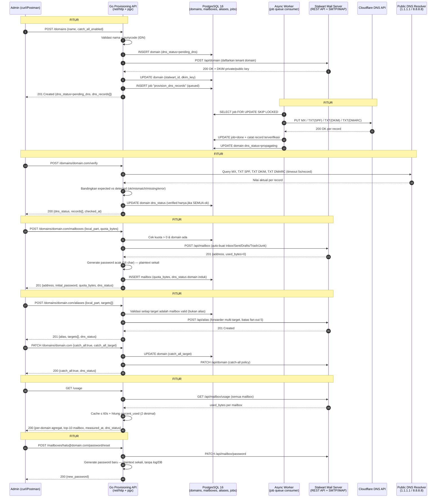
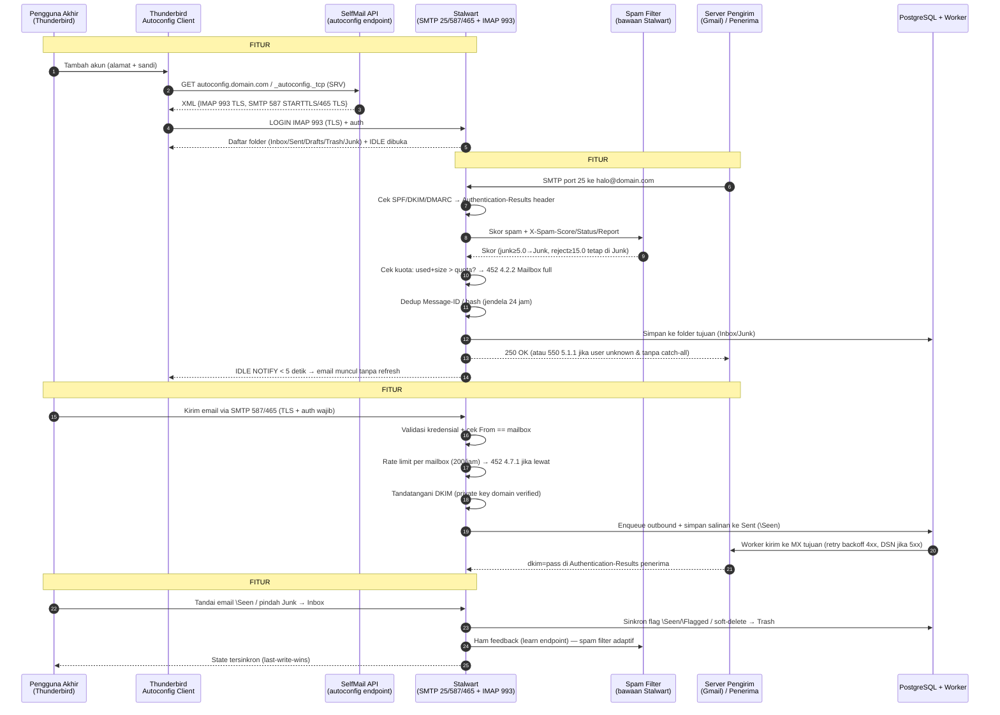
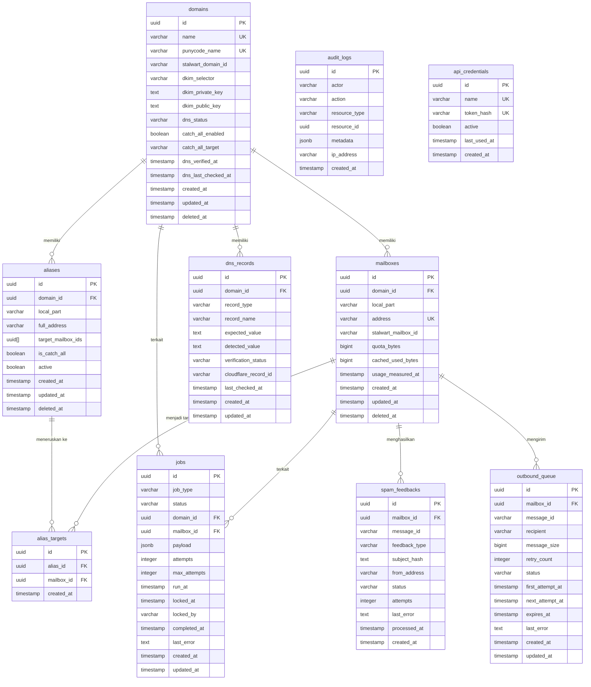

# PRD — Product Requirements Document

**Produk:** SelfMail API

> Layanan email self-hosted backend-only dengan provisioning via REST API, dirancang untuk satu admin yang ingin kendali penuh atas domain dan data email tanpa kerumitan webmail.

---

## Overview

## Ringkasan Produk

**SelfMail API** adalah layanan email self-hosted backend-only yang dirancang untuk administrator tunggal yang menginginkan kendali penuh atas domain dan data email tanpa kerumitan mengelola server email sendiri. Produk ini menyediakan lapisan provisioning berbasis REST API yang memungkinkan admin membuat domain, mailbox, alias, dan mengatur kuota dengan mudah, sementara pengguna akhir tetap menggunakan klien email favorit mereka seperti Thunderbird, Outlook, atau Apple Mail. Dengan mengandalkan Stalwart sebagai server email mapan, SelfMail API menawarkan solusi ringan (RAM < 2 GB) yang mengatasi kompleksitas konfigurasi SMTP/IMAP, DKIM/SPF/DMARC, dan deliverability.

Produk ini menjembatani gap antara penyedia email hosted yang mahal per pengguna (Gmail Workspace, Microsoft 365) dan solusi self-hosted yang berat atau memerlukan konfigurasi manual (Mailcow, docker-mailserver). SelfMail API hadir sebagai satu-satunya solusi backend-only yang menggabungkan kesederhanaan operasional—satu server, satu database, satu worker—dengan API provisioning terpadu yang transparan. Admin dapat mengotomatiskan seluruh siklus hidup email, mulai dari pembuatan domain hingga verifikasi DNS, tanpa menyentuh file konfigurasi.

Dengan fokus pada transparansi status DNS dan penanganan kegagalan yang eksplisit, SelfMail API memastikan admin selalu mengetahui status sebenarnya dari domain mereka. Produk ini juga cocok untuk pengembang yang ingin mempelajari arsitektur email server modern melalui proyek nyata dengan dokumentasi API yang lengkap.

## Core Problem

Banyak pemilik domain menginginkan alamat email profesional (misalnya halo@domain.com) dengan kendali penuh atas data dan tanpa biaya per-seat yang mahal. Namun, membangun dan mengelola server email sendiri sangat kompleks: melibatkan konfigurasi SMTP/IMAP, penanganan spam, DKIM/SPF/DMARC, dan deliverability yang rumit. Solusi yang ada seperti Mailcow membutuhkan sumber daya besar (6 GB RAM) atau docker-mailserver yang tidak memiliki API provisioning terpadu. Selain itu, tidak ada solusi backend-only yang ringan dan menyediakan API provisioning untuk kebutuhan satu admin. SelfMail API mengisi celah tersebut dengan menyediakan layanan email self-hosted yang mengandalkan server email mapan (Stalwart) dan menyediakan lapisan provisioning berbasis REST API. Admin dapat dengan mudah membuat domain, mailbox, alias, dan mengatur kuota melalui API, sementara pengguna akhir tetap menggunakan klien email favorit mereka tanpa perlu adaptasi.

## Target Users / Personas

1. **Admin Tunggal (Pemilik Proyek)**  
   Pengguna teknis yang mengelola server sendiri, nyaman dengan curl/Postman, dan ingin mengotomatiskan provisioning domain, mailbox, alias, serta kuota melalui API. Mereka menghargai efisiensi sumber daya dan transparansi status.

2. **Pengguna Akhir (Penerima Email)**  
   Individu yang menggunakan Thunderbird, Outlook, atau klien email standar lainnya. Mereka tidak perlu tahu apa pun tentang server; hanya menerima alamat email, kata sandi, dan pengaturan IMAP/SMTP. Pengalaman email mereka tetap standar dan familiar.

3. **Pengembang yang Belajar**  
   Individu yang ingin mempelajari arsitektur email server, provisioning, dan integrasi dengan layanan pihak ketiga (Stalwart) melalui proyek nyata. Mereka akan menggunakan dokumentasi API dan mungkin berkontribusi pada pengembangan.

## Key Value Proposition

SelfMail API adalah satu-satunya solusi backend-only untuk email self-hosted yang menggabungkan kesederhanaan operasional (satu server, satu database, satu worker) dengan provisioning via REST API yang transparan. Ini memungkinkan admin mengelola domain dan mailbox tanpa menyentuh file konfigurasi, sementara pengguna akhir menikmati pengalaman email standar melalui klien favorit mereka. Berbeda dari kompetitor, SelfMail API memberikan status DNS yang jujur (fail-closed) dan penanganan kegagalan yang eksplisit, sehingga admin selalu memiliki kendali dan visibilitas penuh.

## Success Metrics

- **Waktu provisioning domain dan mailbox** dari permintaan API hingga siap digunakan: target < 5 menit, termasuk verifikasi DNS.
- **Tingkat keberhasilan pengiriman email keluar** ke Gmail/Outlook tanpa masuk spam: target > 95% setelah IP warming.
- **Jumlah email yang ditolak karena kuota penuh** dengan alasan jelas: target 100% penolakan disertai alasan.
- **Waktu respons API** untuk operasi CRUD: target < 200ms untuk 95% permintaan.
- **Penggunaan RAM server** sesuai target: Stalwart < 2 GB, Mailcow < 6 GB (sebagai perbandingan).
- **Tingkat kesalahan provisioning**: target < 1% dari total permintaan.

## Competitive Landscape

Lanskap kompetitif terbagi menjadi dua kategori: penyedia email hosted (Gmail Workspace, Microsoft 365, Zoho Mail) dan solusi self-hosted (Mailcow, docker-mailserver, Mail-in-a-Box). Penyedia hosted menawarkan kemudahan tetapi mahal per pengguna dan kurangnya kendali data. Solusi self-hosted ada, tetapi Mailcow membutuhkan sumber daya besar (6 GB RAM) dan docker-mailserver tidak memiliki API provisioning. Stalwart muncul sebagai alternatif modern dengan REST API, tetapi belum banyak dikenal. SelfMail API membedakan diri dengan fokus pada backend-only, provisioning API, dan penggunaan Stalwart untuk efisiensi sumber daya. Keunikan proyek terletak pada pendekatan minimalis dan transparansi status DNS, yang jarang ditemukan di solusi lain. Namun, proyek ini harus bersaing dengan solusi yang sudah matang dan memiliki komunitas besar.

---

## Requirements

## Technical Requirements — SelfMail API

Dokumen ini mendefinisikan persyaratan teknis (functional & non-functional) untuk **SelfMail API**, layanan email self-hosted backend-only dengan provisioning via REST API. Semua requirements diturunkan dari Product Analysis, Core Features (#1–#10), User Flow (Alur 1–5), System Architecture, dan Database Schema yang telah ditetapkan sebelumnya.

**Prinsip arsitektur yang mengikat seluruh requirements:**
1. **Backend-only** — tanpa webmail, tanpa UI baca email, tanpa aplikasi klien.
2. **Tanpa menulis SMTP/IMAP sendiri** — delegasi penuh ke Stalwart.
3. **Satu server, satu database, satu worker** — tanpa Kubernetes/message broker/microservice.
4. **DNS jujur & fail-closed** — `verified` hanya jika query DNS aktual mengonfirmasi; tidak pernah melaporkan selesai palsu.
5. **Tidak ada kegagalan diam-diam** — setiap penolakan (kuota, rate limit, alamat tidak dikenal, bounce) memberi alasan eksplisit.
6. **Plaintext password hanya sekali** — tidak pernah ke log/DB.

---

## Functional Requirements

### FR-01: Provisioning Domain via REST API
- **Deskripsi**: Sistem harus menyediakan `POST /domains` yang menerima `{name, catch_all_enabled?}`, memvalidasi nama domain (termasuk konversi IDN ke punycode via `x/net/idna`), menyimpan ke tabel `domains` dengan `dns_status = 'pending'`, mendaftarkan tenant domain ke Stalwart REST API, menyimpan `stalwart_domain_id` dan pasangan kunci DKIM, lalu meng-enqueue job `provision_dns_records` ke tabel `jobs`. Respons `201 Created` wajib memuat `id`, `name`, `dns_status`, dan `dns_records[]` (MX, SPF/TXT, DKIM selector/TXT, DMARC/TXT) berikut nilai `expected`. `GET /domains/{name}` mengembalikan detail domain; `DELETE /domains/{name}` menghapus seluruh mailbox/alias terkait di Stalwart dan DB.
- **Dependensi**: FR-17 (job queue), FR-20 (integrasi Stalwart), FR-21 (integrasi Cloudflare), skema `domains`, `jobs`.
- **Validasi**:
  - `POST /domains` dengan domain valid → `201`, baris `domains` bertambah, satu job `provision_dns_records` tercipta berstatus `queued`.
  - Domain duplikat → `409 Conflict`.
  - Domain IDN (`éxample.com`) → `punycode_name` terisi `xn--...`, query DNS memakai punycode.
  - `DELETE /domains/{name}` dengan mailbox aktif → `409` berisi daftar mailbox yang menghalangi; jika bersih → `204` dan baris Stalwart + DB terhapus.
  - Setiap respons memuat `dns_status` ∈ `{pending, propagating, verified, failed, error}` dan `pending_records[]`.

### FR-02: Verifikasi DNS Jujur (Fail-Closed)
- **Deskripsi**: Sistem harus menyediakan `GET /domains/{name}/status`, `POST /domains/{name}/verify`, dan `GET /domains/{name}/dns-records`. Verifikasi melakukan query DNS **aktual** ke resolver publik (1.1.1.1/8.8.8.8, tanpa cache lokal) untuk MX, SPF/TXT, DKIM selector/TXT, dan DMARC/TXT dengan timeout **5 detik per record**. Nilai terdeteksi dibandingkan dengan `expected` dan menghasilkan status per-record: `ok`/`mismatch`/`missing`/`error`. `dns_status` agregat = `verified` **hanya jika semua record `ok`**; query gagal/timeout → status record `error` (bukan `ok`). `GET /domains/{name}/dns-records` mengembalikan daftar record `expected` lengkap (termasuk DKIM public key aktual dari Stalwart) untuk pembuatan manual. Status DNS disimpan di `dns_records.verification_status` dan `domains.dns_status`.
- **Dependensi**: FR-01, FR-20 (DKIM public key dari Stalwart), skema `dns_records`, `domains`.
- **Validasi**:
  - Record belum dibuat → `missing`; `dns_status` = `propagating`/`pending`.
  - Record ada dengan nilai berbeda (MX lama) → `mismatch` (bukan `missing`/`ok`), tidak ada penimpaan otomatis.
  - Semua 4 record benar → `verified`, `dns_verified_at` terisi.
  - Resolver down → record `error`, bukan `ok` (fail-closed).
  - Multi-record SPF yang sudah berisi `include` server → status `ok` (deteksi include), bukan `mismatch`.
  - CNAME vs TXT untuk DKIM → keduanya diterima.
  - `checked_at` disertakan dan mencerminkan waktu query aktual.

### FR-03: Manajemen Mailbox (CRUD, Kata Sandi, Kuota)
- **Deskripsi**: Sistem harus menyediakan `POST /domains/{domain}/mailboxes` (`{local_part, quota_bytes, password?}`), `GET /domains/{domain}/mailboxes`, `GET /mailboxes/{address}`, `PATCH /mailboxes/{address}` (`{quota_bytes}`), `POST /mailboxes/{address}/password/reset`, dan `DELETE /mailboxes/{address}`. Pembuatan meneruskan ke Stalwart yang otomatis membuat folder standar (Inbox, Sent, Drafts, Trash, Junk), menyimpan metadata di `mailboxes`, dan mengembalikan `initial_password` **plaintext hanya sekali** jika kata sandi di-generate otomatis (16 karakter acak kuat via `crypto/rand`). `DELETE` mengembalikan `{deleted_messages_count}`. Setiap respons mailbox memuat `dns_status` domain induk.
- **Dependensi**: FR-01, FR-20 (Stalwart), skema `mailboxes`.
- **Validasi**:
  - `POST` tanpa `password` → respons memuat `initial_password` 16 karakter; dengan `password` → `initial_password` tidak dikembalikan.
  - `quota_bytes <= 0` → `400`; `local_part` duplikat → `409`.
  - `PATCH quota_bytes` < pemakaian saat ini → `409 "quota below current usage"`; jika valid → tercermin di `GET /mailboxes/{address}` segera.
  - `POST .../password/reset` → `200 {new_password}` sekali; tidak ada plaintext di `audit_logs` maupun DB (diverifikasi via query DB & grep log).
  - `DELETE` → `200 {deleted_messages_count}`, baris Stalwart + DB terhapus.
  - Password disuplai lemah (< 12 karakter/tanpa variasi) → `400` dengan petunjuk syarat.
  - Stalwart tidak merespons → `503` + `retry_after`, job provisioning masuk retry.

### FR-04: Manajemen Alias dan Catch-All
- **Deskripsi**: Sistem harus menyediakan `POST /domains/{domain}/aliases` (`{local_part, targets[]}`, min 1 & maks 5 target, semua target harus mailbox valid — bukan alias), `GET /domains/{domain}/aliases`, `DELETE /domains/{domain}/aliases/{local_part}`, dan `PATCH /domains/{domain}` (`{catch_all, catch_all_target?}`). Alias didaftarkan ke Stalwart sebagai forwarder multi-target dan dicatat di `aliases` + `alias_targets` (many-to-many). Catch-all disimpan di `domains.catch_all_enabled` + `catch_all_target` dan disinkronkan ke Stalwart. Prioritas resolusi: mailbox > alias > catch-all.
- **Dependensi**: FR-01, FR-03, FR-20, skema `aliases`, `alias_targets`.
- **Validasi**:
  - Alias ke mailbox yang tidak ada → `400` dengan daftar target invalid.
  - Target alias→alias (loop) → `400`; targets kosong → `400`; > 5 target → `400`.
  - `PATCH catch_all: true` tanpa target → `400`.
  - Email ke alamat tidak terdaftar saat catch-all `false` → `550 5.1.1`; saat `true` → diteruskan ke target, tercatat di log dengan header `X-SelfMail-Catch-All: true`.
  - Alias dengan `local_part` = mailbox existing → `409`.

### FR-05: Penerimaan Email Masuk (Inbound SMTP, Filter Spam, Kuota, Dedup)
- **Deskripsi**: Stalwart menerima email di port 25 untuk semua domain/mailbox terdaftar. Sistem harus dikonfigurasi agar: (a) memeriksa SPF/DKIM/DMARC dan mencatat hasil di header `Authentication-Results`; (b) menambahkan header `X-Spam-Score`, `X-Spam-Status`, `X-Spam-Report`; (c) merutekan email dengan skor ≥ `junk_threshold` ke `Junk` (**tidak dibuang**), skor ≥ `reject_threshold` tetap di `Junk`; (d) menolak email bila `used_bytes + message_size > quota_bytes` dengan `452 4.2.2 Mailbox full` (pesan besar: `552`); (e) menolak alamat tidak terdaftar dengan `550 5.1.1 User unknown in virtual mailbox table`; (f) menerapkan dedup berbasis `Message-ID` (fallback hash sender+recipient+date+subject+body, jendela 24 jam/1 jam); (g) menegakkan `max_message_size` (default 25 MB → `552 5.3.4`); (h) menegakkan rate limit per IP pengirim (default 100/menit/IP). Semua event penerimaan dicatat di log (sender, recipient, size, spam score, action).
- **Dependensi**: FR-01, FR-03, FR-06, konfigurasi Stalwart (port 25, spam filter, kuota, dedup, size limit).
- **Validasi**:
  - Email dari Gmail ke mailbox terdaftar → Inbox, terlihat via IMAP.
  - Alamat tidak terdaftar tanpa catch-all → `550 5.1.1`.
  - Email skor ≥ junk_threshold → Junk + header spam ada.
  - Lampiran > max_message_size → `552 5.3.4`, tidak parsial.
  - Kuota terlampaui → `452 4.2.2`, tanpa menyimpan sebagian.
  - Retry dengan `Message-ID` sama dalam 24 jam → hanya 1 salinan, tetap `250 OK`.
  - Email berukuran tepat di batas kuota (`used+size == quota`) → diterima (kondisi `>`).

### FR-06: Konfigurasi Threshold Spam (Konfigurabel)
- **Deskripsi**: `junk_threshold` (default 5.0) dan `reject_threshold` (default 15.0) harus dapat dikonfigurasi per instalasi via environment variable / file config (bukan hardcode), dan diterapkan ke konfigurasi filter spam Stalwart saat startup/provisioning.
- **Dependensi**: FR-05 (inbound), konfigurasi Stalwart.
- **Validasi**: Mengubah env `SPAM_JUNK_THRESHOLD` lalu restart → email dengan skor yang relevan berpindah folder sesuai threshold baru; nilai tidak tercetak sebagai literal di kode (grep kode).

### FR-07: Pengiriman Email Keluar (SMTP Submission, DKIM, Rate Limit, Antrean)
- **Deskripsi**: Stalwart menerima submission email di port 587 (STARTTLS) dan 465 (TLS) dengan **autentikasi + TLS wajib** (tanpa auth/TLS → `535 5.7.8`). Sistem mengonfigurasi Stalwart untuk: menandatangani dengan DKIM menggunakan private key per domain yang sudah terverifikasi; menegakkan rate limit per mailbox (default 200/jam, cabang `452 4.7.1 Try again later`); menolak `From` yang bukan milik mailbox (`550 5.7.1`); menyimpan salinan ke folder `Sent` (`\Seen`); meng-enqueue ke antrean kirim dengan retry backoff progresif (5m, 15m, 1j, 4j, ...) untuk kegagalan 4xx dan batas waktu **5 hari**; mengirim bounce DSN ke Inbox pengirim sebagai `Mail Delivery Subsystem` untuk kegagalan 5xx/permanen. Bila DKIM key belum siap (domain belum verified) → submission ditolak dengan pesan jelas. Antrean dicerminkan di tabel `outbound_queue`.
- **Dependensi**: FR-01 (DKIM key), FR-03, FR-05, konfigurasi Stalwart (submission, DKIM, queue, rate limit), skema `outbound_queue`.
- **Validasi**:
  - Submission tanpa TLS → ditolak; tanpa auth/salah → `535 5.7.8`.
  - Email ke Gmail → `dkim=pass` di `Authentication-Results` penerima.
  - Rate limit terlampaui → `452 4.7.1`, reset tiap jam.
  - 4xx dari MX tujuan → retry dengan backoff, tidak langsung bounce.
  - 5xx / batas 5 hari → bounce DSN muncul di Inbox pengirim.
  - Salinan di folder `Sent` terlihat via IMAP dengan flag `\Seen`.
  - `From` manipulasi domain lain → `550 5.7.1`.
  - Relay loop / forward ke diri sendiri → ditolak (deteksi `Received`).

### FR-08: IMAP dengan TLS, Folder Standar, Sinkronisasi Status, dan IDLE
- **Deskripsi**: Stalwart menyediakan IMAP port 993 (TLS) dan 143 (STARTTLS saja). Kelima folder standar (Inbox, Sent, Drafts, Trash, Junk) dibuat otomatis saat mailbox dibuat. Sinkronisasi dua arah `\Seen`, `\Flagged`, `\Deleted` (soft delete → Trash, `EXPUNGE` → permanen). IDLE didukung sehingga email baru muncul di klien **< 5 detik** tanpa refresh manual. Header spam terekspos via `FETCH BODY.PEEK[HEADER.FIELDS (X-SPAM-SCORE X-SPAM-STATUS X-SPAM-REPORT)]`.
- **Dependensi**: FR-03 (mailbox), FR-05 (penyimpanan email), konfigurasi Stalwart (IMAP, TLS, IDLE).
- **Validasi**:
  - Tanpa TLS di 143 tanpa STARTTLS → ditolak.
  - Kredensial valid berhasil; salah ditolak.
  - Kelima folder ada segera setelah mailbox dibuat.
  - Flag `\Seen` tersinkron antar klien (last-write-wins).
  - Email baru tampil < 5 detik via IDLE.
  - Header spam terbaca di folder Junk.
  - Draft tersinkron antar perangkat.
  - `FETCH` folder < 10.000 email responsif (< 500ms).

### FR-09: Penyaringan Spam Adaptif (Feedback "Bukan Spam"/"Spam")
- **Deskripsi**: Sistem harus mendeteksi perpindahan email dari `Junk` → `Inbox` (menandai ham) dan `Inbox` → `Junk` (menandai spam), mencatatnya di tabel `spam_feedbacks` (unik per `mailbox_id`+`message_id`), lalu mengirim feedback ke Stalwart learn endpoint. Mekanisme penggunaan tabel ini (trigger berbasis polling kesenjangan flag IMAP per-mailbox, atau Stalwart hook) harus diimplementasikan oleh worker dengan rate limit feedback (default 100/menit/instalasi) agar tidak membebani CPU. Feedback diproses per-mailbox (preferensi tidak saling menimpa).
- **Dependensi**: FR-05, FR-08, konfigurasi Stalwart (learn endpoint), skema `spam_feedbacks`.
- **Validasi**:
  - Pindah Junk→Inbox → baris `spam_feedbacks` `feedback_type='ham'`, status `sent` setelah diproses.
  - Pindah Inbox→Junk → `feedback_type='spam'`.
  - Feedback ganda untuk `mailbox_id`+`message_id` yang sama → dicegah (unique constraint).
  - Email sudah dihapus sebelum diproses → status `skipped` (graceful).
  - Tidak ada email hilang — semua email ada di salah satu folder.

### FR-10: Pelaporan Pemakaian (Usage) per Mailbox dan Domain
- **Deskripsi**: `GET /mailboxes/{address}` mengembalikan `{used_bytes, quota_bytes, percent_used (2 desimal), over_quota, measured_at, dns_status}`; `GET /domains/{domain}` mengembalikan agregat `{total_used_bytes, total_quota_bytes, mailbox_count, mailbox_count_near_quota (> 80%), measured_at, dns_status}`; `GET /usage` mengembalikan snapshot seluruh instalasi (agregat per domain + top-10 mailbox). `used_bytes` diambil langsung dari Stalwart REST API (bukan estimasi) dan di-cache ≤ 60 detik di `mailboxes.cached_used_bytes` + `usage_measured_at`. Jika cache lebih tua dari 5 menit atau Stalwart tidak dapat dihubungi → `503` (tidak mengembalikan 0 atau cache basi).
- **Dependensi**: FR-01, FR-03, FR-20, skema `mailboxes`.
- **Validasi**:
  - Mailbox baru → `used_bytes: 0`, `measured_at` = sekarang.
  - `percent_used` dibulatkan 2 desimal; `over_quota: true` bila `used > quota`.
  - Stalwart timeout → `503`.
  - Domain 0 mailbox → agregat `0/0`, `percent_used: 0`.
  - Panggilan bersamaan banyak `GET /mailboxes/{address}` → cache mencegah N+1.

### FR-11: Autoconfig/Autodiscover (Thunderbird & Outlook)
- **Deskripsi**: Sistem harus menyediakan endpoint HTTP yang melayani `GET /mail/config-v1.1.xml` dan `/.well-known/autoconfig/mail/config-v1.1.xml` yang mengembalikan XML berisi pengaturan IMAP (port 993 SSL/TLS) dan SMTP submission (port 587 STARTTLS, 465 SSL/TLS), agar Thunderbird dapat menambahkan akun hanya dengan alamat email + kata sandi. XML harus menyertakan `username` placeholder (`%EMAILADDRESS%`) dan sesuai skema Thunderbird autoconfig. Opsional: SRV `_autoconfig._tcp` (dikonfigurasi di DNS).
- **Dependensi**: FR-01, FR-08, konfigurasi Stalwart, DNS.
- **Validasi**:
  - `GET /mail/config-v1.1.xml?emailaddress=halo@domain.com` → `200` XML valid, memuat IMAP 993 & SMTP 587/465.
  - Thunderbird tambah akun hanya dengan email+sandi → tidak menampilkan form manual (autoconfig berhasil).
  - XML lolos validasi terhadap skema Thunderbird.
  - Content-Type `application/xml`.

### FR-12: Autentikasi & Otorisasi Admin API
- **Deskripsi**: Seluruh endpoint API admin (`/domains`, `/mailboxes`, `/usage`, dll.) wajib dilindungi token API. Token dikelola di tabel `api_credentials` (hash SHA-256, `name` unik, `active`). Request wajib menyertakan bearer token; token invalid/nonaktif → `401`; request ke endpoint terproteksi tanpa token → `401`. `last_used_at` diperbarui. Semua aksi tercatat di `audit_logs` (tanpa plaintext password).
- **Dependensi**: skema `api_credentials`, `audit_logs`.
- **Validasi**:
  - Tanpa header Authorization → `401`.
  - Token invalid/nonaktif → `401`.
  - Token valid → `200`/sesuai operasi, `last_used_at` ter-update.
  - Setiap aksi mutasi menghasilkan baris `audit_logs` dengan `actor` = nama token.

### FR-13: Pencatatan Audit Log
- **Deskripsi**: Setiap aksi mutasi admin (create/delete domain, create/patch/delete mailbox, reset password, create/delete alias, patch catch-all) harus menulis baris ke `audit_logs` dengan `actor`, `action`, `resource_type`, `resource_id`, `metadata` (JSONB, tanpa plaintext password), `ip_address`, `created_at`.
- **Dependensi**: FR-12, skema `audit_logs`.
- **Validasi**:
  - Operasi `reset_password` → tidak ada field password di `metadata` (diverifikasi query DB).
  - Setiap operasi mutasi menghasilkan tepat satu baris audit.
  - `resource_type`/`resource_id` konsisten dengan resource yang dimutasi.

### FR-14: Idempotensi Operasi Provisioning
- **Deskripsi**: Operasi yang memicu penulisan ke Stalwart dan Cloudflare harus idempoten. `provision_dns_records` menggunakan `cloudflare_record_id` yang tersimpan untuk update (bukan duplikasi). Registrasi domain ke Stalwart memakai identitas yang dapat dicek ulang (jika sudah ada, jangan buat duplikat). Reconciliation job mendeteksi dan menyelaraskan state tidak konsisten (domain terdaftar di Stalwart tapi belum di DB, atau sebaliknya) — mencakup `domains`, `mailboxes`, `aliases`.
- **Dependensi**: FR-01, FR-17, FR-20, FR-21.
- **Validasi**:
  - Menjalankan ulang job `provision_dns_records` dua kali → tidak ada record duplikat di Cloudflare (tetap 4 record).
  - Simulasi crash setelah Stalwart create tapi sebelum DB commit → job reconciliation mendeteksi dan menyelaraskan tanpa duplikasi.
  - Replay `POST /domains` dengan domain existing → `409`, tidak membuat tenant Stalwart kedua.

### FR-15: Soft Delete & Crash Recovery
- **Deskripsi**: `domains`, `mailboxes`, `aliases` menggunakan `deleted_at` (soft delete). Hard delete hanya dilakukan setelah konfirmasi bersih di Stalwart. Reconciliation job membaca baris soft-deleted dan memastikan Stalwart juga menghapus (atau sebaliknya). Query operasional mengabaikan baris dengan `deleted_at IS NOT NULL`.
- **Dependensi**: FR-01, FR-03, FR-04, FR-17, skema `domains`, `mailboxes`, `aliases`.
- **Validasi**:
  - `DELETE /mailboxes/{address}` → baris DB `deleted_at` terisi, tidak muncul di `GET /domains/{domain}/mailboxes`.
  - Reconciliation job mendeteksi mailbox soft-deleted yang masih ada di Stalwart → menghapusnya di Stalwart.
  - Simulasi crash saat hapus → state akhir konsisten (dihapus di kedua sisi atau dikembalikan).

### FR-16: Antrean Kirim Keluar Persisten (Outbound Queue)
- **Deskripsi**: Tabel `outbound_queue` mencatat setiap pesan keluar dengan `mailbox_id`, `message_id`, `recipient`, `message_size`, `retry_count`, `status` (`queued`/`sending`/`sent`/`bounced`/`failed`), `first_attempt_at`, `next_attempt_at`, `expires_at` (default 5 hari), `last_error`. Worker mengambil entri `status='queued' AND next_attempt_at <= now()` dengan `FOR UPDATE SKIP LOCKED`, mengirim, dan memperbarui status/backoff. Entri kedaluwarsa menghasilkan bounce DSN.
- **Dependensi**: FR-07, FR-17, skema `outbound_queue`.
- **Validasi**:
  - 4xx → `retry_count` bertambah, `next_attempt_at` maju sesuai backoff, status kembali `queued`.
  - 5xx/expired → status `bounced` dan DSN terkirim ke Inbox pengirim.
  - Sukses → status `sent`.
  - Dua worker bersamaan tidak memproses entri yang sama (SKIP LOCKED).

### FR-17: Job Queue In-Postgres dengan Retry Backoff
- **Deskripsi**: Tabel `jobs` dengan `job_type` (`provision_dns_records`, `verify_dns`, `provision_mailbox`, `delete_mailbox`, `delete_domain`, `sync_usage`, `spam_feedback`), `status` (`queued`/`running`/`done`/`failed`), `payload` (JSONB), `attempts`/`max_attempts` (default 5), `run_at`, `locked_at`, `locked_by`, `last_error`. Worker tunggal (satu proses goroutine loop) memakai `SELECT ... FOR UPDATE SKIP LOCKED WHERE status='queued' AND run_at <= now()`, mengeksekusi, lalu `done` atau `failed` dengan backoff eksponensial (`run_at` dimajukan). Tidak ada message broker eksternal.
- **Dependensi**: skema `jobs`.
- **Validasi**:
  - Job gagal → `attempts` bertambah, `last_error` terisi, `run_at` maju (backoff).
  - Setelah `max_attempts` → status `failed` permanen.
  - Job ter-lock tidak diambil worker lain.
  - Restart worker → job `running` yang macet di-recover (lewat `locked_at` kedaluwarsa).

### FR-18: Sinkronisasi Status DNS Konsisten di Seluruh Respons
- **Deskripsi**: `dns_status` yang dikembalikan di endpoint mailbox, alias, dan usage harus konsisten dengan `GET /domains/{domain}/status` — mengambil dari cache yang sama (`domains.dns_status` + `dns_last_checked_at`) dengan refresh maksimal 5 menit. Setiap respons yang menyertakan detail domain/mailbox memuat `dns_status` dan `pending_records[]` (kosong jika `verified`).
- **Dependensi**: FR-02, FR-03, FR-04, FR-10.
- **Validasi**:
  - Memanggil `GET /mailboxes/{address}` dan `GET /domains/{domain}/status` dalam jendela < 5 menit → `dns_status` identik.
  - Cache kadaluwarsa (> 5 menit) → refresh dari query DNS aktual.
  - `pending_records[]` kosong ⇔ `dns_status = verified`.

### FR-19: Endpoint Health & Readiness
- **Deskripsi**: Sistem menyediakan endpoint (mis. `GET /healthz` dan `GET /readyz`) yang melaporkan status liveness proses API/worker, konektivitas PostgreSQL, dan (untuk readiness) keterjangkauan Stalwart REST API. Tidak memerlukan autentikasi.
- **Dependensi**: FR-12 (pengecualian auth), FR-20.
- **Validasi**:
  - DB down → `/readyz` kembalikan `503`.
  - Stalwart unreachable → `/readyz` kembalikan `503`.
  - Normal → `200` dengan detail komponen.

### FR-20: Integrasi Stalwart REST API
- **Deskripsi**: Klien HTTP internal Go (`net/http` + timeout & retry terkontrol) ke REST API Stalwart untuk: registrasi domain/tenant + generate DKIM, buat baca/ubah/hapus mailbox, konfigurasi quota, buat/hapus alias, set catch-all policy, baca `used_bytes`, kirim spam feedback (learn endpoint), dan konfigurasi spam threshold/rate limit. Kegagalan koneksi/timeout → `503` dengan `retry_after` di API admin; job provisioning masuk retry.
- **Dependensi**: Konfigurasi Stalwart, FR-17.
- **Validasi**:
  - Membuat mailbox via API → muncul di Stalwart (verifikasi langsung via REST API Stalwart).
  - Stalwart down → API admin mengembalikan `503`; job provision masuk retry.
  - Generate DKIM → public key tersimpan di `domains.dkim_public_key` dan cocok dengan yang dipublikasi ke DNS.

### FR-21: Integrasi Cloudflare DNS API
- **Deskripsi**: Klien HTTP internal Go ke Cloudflare API untuk membuat/memperbarui/menghapus record MX, TXT (SPF/DKIM/DMARC). Menggunakan `cloudflare_record_id` tersimpan untuk update idempoten. Kegagalan masuk retry dengan backoff; `dns_status` tetap `pending`/`propagating`. Tidak menimpa record berbeda (MX lama) tanpa konfirmasi — melaporkan `mismatch`.
- **Dependensi**: FR-01, FR-02, FR-17.
- **Validasi**:
  - `POST /domains` memicu pembuatan 4 record di Cloudflare (verifikasi via API Cloudflare).
  - Re-run job → tidak ada duplikat.
  - Cloudflare down → job retry, `dns_status` = `pending`.
  - Record existing berbeda → tidak ditimpa, dilaporkan `mismatch`.

### FR-22: Konfigurasi Runtime via Environment/Config
- **Deskripsi**: Seluruh parameter operasional harus konfigurabel via environment/file config (tanpa recompile, tanpa hardcode): kredensial Cloudflare, URL & kredensial Stalwart, DSN PostgreSQL, `junk_threshold`, `reject_threshold`, `max_message_size`, rate limit submission (200/jam), rate limit inbound per IP (100/menit), rate limit feedback (100/menit), retry backoff & batas antrean (5 hari), timeout DNS (5s), TTL cache usage (60s) & batas basi (5m), fan-out alias maks (5), panjang password default (16).
- **Dependensi**: FR-06, FR-07, FR-10, FR-17, FR-20, FR-21.
- **Validasi**:
  - Mengubah env lalu restart → perilaku berubah sesuai nilai baru.
  - Tidak ada secret/param di-hardcode (grep kode).
  - Config invalids (mis. threshold negatif) → proses gagal start dengan error jelas.

### FR-23: Penanganan Konflik & Error Eksplisit
- **Deskripsi**: Semua kondisi error operasional harus dikembalikan dengan kode status & body eksplisit (bukan silent): `400` (input invalid, quota ≤ 0, loop alias, targets kosong), `401` (auth), `404` (resource tidak ada), `409` (konflik: domain/mailbox/alias duplikat, quota < usage, delete terhalang), `503` (Stalwart/DB tidak tersedia, dengan `retry_after`). Respons error memuat `code`, `message`, dan detail terstruktur.
- **Dependensi**: Seluruh FR fungsional.
- **Validasi**:
  - Setiap skenario di atas mengembalikan kode yang sesuai dengan body terstruktur.
  - Tidak ada `500` untuk error yang dapat diprediksi (validasi dilakukan sebelum panggilan Stalwart).
  - `503` menyertakan header/body `retry_after` bernilai positif.

### FR-24: Pemisahan Inbox/Junk berdasarkan Snapshot Skor
- **Deskripsi**: Header spam (`X-Spam-Score`, `X-Spam-Status`, `X-Spam-Report`) yang ditambahkan saat penerimaan adalah **snapshot** dan tidak diubah retroaktif setelah email tersimpan. Routing Inbox/Junk ditentukan sekali saat penerimaan berdasarkan threshold saat itu. Administrasi/filter ulang tidak menulis ulang header.
- **Dependensi**: FR-05, FR-09.
- **Validasi**: Mengubah threshold setelah email masuk tidak mengubah header email yang sudah ada (verifikasi via IMAP setelah threshold diubah).

### FR-25: DSN Bounce & Laporan Kegagalan
- **Deskripsi**: Kegagalan permanen (5xx) atau kedaluwarsa antrean (5 hari) pada outbound_queue harus menghasilkan DSN (`multipart/report; report-type=delivery-status`) yang dikirim ke Inbox mailbox pengirim sebagai `Mail Delivery Subsystem`, memuat alasan teknis dan header pesan asli. Bounce tetap dikirim walau pesan asli sudah dihapus pengirim (informasi harus diterima pengguna).
- **Dependensi**: FR-07, FR-16, FR-17.
- **Validasi**:
  - Simulasi 5xx dari MX tujuan → DSN muncul di Inbox pengirim, From `Mail Delivery Subsystem`.
  - Simulasi expired (5 hari) → DSN terkirim.
  - DSN memuat `Message-ID` pesan asli & alasan teknis.

---

## Non-Functional Requirements

### Performance

- **NFR-P01**: Operasi CRUD API (create/get/patch/delete domain, mailbox, alias) harus merespons dalam **< 200ms pada persentil ke-95** (tidak termasuk operasi sinksron yang memanggil Stalwart/Cloudflare yang dilakukan asinkron; operasi sinkron yang wajib memanggil Stalwart harus memiliki timeout terkontrol dan `503` yang jelas).
- **NFR-P02**: `GET /usage` untuk instalasi dengan ≤ 50 domain dan ≤ 500 mailbox harus selesai dalam **< 2 detik** (terutama karena cache ≤ 60 detik; tidak boleh N+1 ke Stalwart).
- **NFR-P03**: Verifikasi DNS (`GET /status`, `POST /verify`) harus selesai dalam **< 20 detik** untuk 4 record (timeout 5s/record, query paralel atau sequential dengan budget total terkontrol).
- **NFR-P04**: Email baru yang masuk harus tampil di klien IMAP via IDLE dalam **< 5 detik** (tergantung Stalwart; divalidasi end-to-end).
- **NFR-P05**: Worker job queue harus memproses job dengan latensi dispatch **< 10 detik** dari `run_at` (polling interval terkontrol) pada beban normal.
- **NFR-P06**: `FETCH` IMAP untuk folder < 10.000 email harus responsif **< 500ms** per operand (delegasi ke Stalwart; divalidasi dengan

---

## Core Features

## Daftar Fitur Inti — SelfMail API

Berikut adalah daftar fitur inti untuk SelfMail API, disusun berdasarkan prioritas nilai dan ketergantungan antar fitur. Setiap fitur dirancang untuk mendukung prinsip proyek: **backend-only, satu server, satu database, satu worker, tanpa webmail**.

---

## 1. Provisioning Domain via REST API

- **Deskripsi**: Fitur inti untuk mendaftarkan domain baru ke dalam sistem. Ketika admin memanggil endpoint `POST /domains`, sistem menyimpan metadata domain (nama, ID Stalwart tenant, status verifikasi) ke PostgreSQL, lalu memicu rangkaian pekerjaan asinkron: (a) mendaftarkan domain ke Stalwart via REST API-nya, (b) membuat job untuk menulis DNS record (MX, SPF, DKIM public key, DMARC) ke penyedia DNS melalui Cloudflare API, dan (c) menandai domain berstatus `pending_dns` hingga semua record terverifikasi. Ini adalah gerbang utama seluruh sistem — tanpa domain yang valid, mailbox dan alias tidak bisa dibuat.

  Fitur ini juga mencakup operasi hapus domain (`DELETE /domains/{name}`) yang akan menghapus semua mailbox terkait setelah konfirmasi, serta menandai record DNS untuk pembersihan. Setiap respons API *wajib* memuat field `dns_status` dengan nilai eksplisit (`pending`, `propagating`, `verified`, `failed`) beserta daftar record yang belum terverifikasi — sistem tidak pernah melaporkan `verified` sebelum hasil query DNS aktual (bukan cache) mengonfirmasi record tersebut.

- **User Story**: Sebagai admin, saya ingin mendaftarkan domain baru lewat satu panggilan API dan melihat status verifikasi DNS-nya secara jujur, sehingga saya tahu persis kapan domain siap dipakai dan tidak perlu menebak-nebak apakah record sudah terpropagasi.

- **Acceptance Criteria**:
  1. `POST /domains` menerima `{name, catch_all_enabled?}` dan mengembalikan `201` dengan objek domain yang memuat `id`, `name`, `dns_status: "pending_dns"`, dan `dns_records[]` (daftar record yang wajib dibuat admin/otomatis).
  2. Domain yang sudah ada mengembalikan `409 Conflict` dengan pesan jelas.
  3. Endpoint `GET /domains/{name}/status` melakukan query DNS aktual (bukan cache) ke resolver publik untuk MX, SPF, DKIM, dan DMARC; melaporkan `verified` hanya jika **semua** record cocok dengan nilai yang diharapkan.
  4. `DELETE /domains/{name}` menghapus domain beserta semua mailbox/alias terkait di Stalwart dan DB, mengembalikan `204`; jika ada mailbox yang tidak bisa dihapus, kembalikan `409` dengan daftar penyebab.
  5. Semua respons API menyertakan field `dns_status` dan `pending_records[]`; jika kosong berarti `verified`.
  6. Pembuatan domain memicu job asinkron (tercatat di tabel `jobs`) untuk penulisan DNS record ke Cloudflare; kegagalan pembuatan record dilaporkan di `dns_status` sebagai `failed` dengan detail error.

- **Prioritas**: **High**
- **Dependensi**: Koneksi Stalwart REST API, koneksi Cloudflare API, skema tabel `domains`, `jobs`, sistem job queue.
- **Edge Cases**:
  - Domain sudah didaftarkan di Stalwart tapi belum di DB (crash recovery) → job reconciliation harus mendeteksi dan menyelaraskan.
  - Domain dengan karakter IDN (Unicode) → decode ke ASCII (punycode) sebelum query DNS.
  - Cloudflare API down → job masuk retry dengan backoff eksponensial; `dns_status` tetap `pending`.
  - Resolver DNS lambat → timeout 5 detik per record, laporkan `propagating`, bukan `failed`.
  - Record DNS sudah ada tapi nilainya berbeda (misal MX lama) → laporkan konflik, jangan timpa otomatis tanpa konfirmasi.

---

## 2. Manajemen Mailbox (CRUD + Kata Sandi + Kuota)

- **Deskripsi**: Fitur untuk membuat, membaca, memperbarui, dan menghapus mailbox. Endpoint `POST /domains/{domain}/mailboxes` membuat mailbox baru di Stalwart, menyimpan metadata (alamat, kuota, hash kata sandi tidak disimpan di sisi kita — cukup di Stalwart), dan mengembalikan **kata sandi awal** dalam plaintext *hanya sekali* pada respons pembuatan. Kata sandi yang di-generate secara acak (default 16 karakter, kuat) jika admin tidak menyuplai; jika disuplai, admin menerima konfirmasi tanpa mengembalikan plaintext.

  Fitur ini juga mencakup operasi `PATCH /mailboxes/{address}` untuk mengubah kuota (`quota_bytes`) yang diteruskan ke Stalwart dan disimpan di DB sebagai sumber kebenaran untuk laporan pemakaian, serta `POST /mailboxes/{address}/password/reset` yang mengembalikan kata sandi baru dalam plaintext sekali. Perubahan kuota berlaku segera di server email (Stalwart mendukung pengecekan kuota pada saat delivery). Operasi hapus (`DELETE`) menghapus mailbox di Stalwart sekaligus di DB, dan mendokumentasikan berapa banyak pesan yang ikut terhapus.

- **User Story**: Sebagai admin, saya ingin membuat mailbox baru dengan kuota tertentu dan menerima kata sandi awal dalam satu panggilan API, sehingga saya bisa langsung menyerahkannya ke pengguna akhir tanpa langkah manual tambahan.

- **Acceptance Criteria**:
  1. `POST /domains/{domain}/mailboxes` menerima `{local_part, quota_bytes, password?}` dan mengembalikan `201` dengan `{address, initial_password (hanya jika auto-generate atau disuplai), quota_bytes, created_at}`. Jika `password` disuplai, `initial_password` tidak dikembalikan (admin sudah tahu).
  2. `PATCH /mailboxes/{address}` menerima `{quota_bytes}` dan meneruskan ke Stalwart; perubahan tercermin di `GET /mailboxes/{address}` segera.
  3. `POST /mailboxes/{address}/password/reset` mengembalikan `200` dengan `{new_password}` dalam plaintext **sekali**; tidak disimpan di log atau DB.
  4. `DELETE /mailboxes/{address}` mengembalikan `200` dengan `{deleted_messages_count}` dan menghapus di kedua sisi.
  5. `GET /domains/{domain}/mailboxes` mengembalikan daftar mailbox dengan `used_bytes` (dari Stalwart) dan `quota_bytes` (dari DB).
  6. Jika kuota baru lebih kecil dari pemakaian saat ini, kembalikan `409` dengan pesan "quota below current usage"; admin harus menghapus email dulu.
  7. Semua respons mailbox memuat `dns_status` domain induk (agar admin tahu domain siap atau belum).

- **Prioritas**: **High**
- **Dependensi**: Fitur #1 (Domain), Stalwart REST API, tabel `mailboxes`.
- **Edge Cases**:
  - `local_part` duplikat di domain yang sama → `409`.
  - `quota_bytes` negatif atau 0 → `400` (harus > 0).
  - Kata sandi yang disuplai lemah (< 12 karakter atau tanpa variasi) → `400` dengan petunjuk persyaratan.
  - Reset kata sandi untuk mailbox yang tidak ada → `404`.
  - Hapus mailbox saat ada email yang sedang dikirim (queued) → job hapus harus menunggu atau membatalkan antrean kirim mailbox tersebut lebih dulu.
  - Stalwart tidak merespons saat pembuatan → kembalikan `503` dengan `retry_after`, job provisioning masuk antrean retry.

---

## 3. Manajemen Alias dan Catch-All

- **Deskripsi**: Fitur untuk membuat alamat yang meneruskan email ke satu atau beberapa mailbox tujuan, tanpa menambah kuota. Endpoint `POST /domains/{domain}/aliases` menerima `{local_part, targets: ["user1@domain", "user2@domain"]}` dan mendaftarkannya di Stalwart sebagai alias/forwarder. Satu sumber email bisa mengalir ke beberapa mailbox sekaligus (fan-out). Alias tidak memiliki mailbox fisik sendiri — tidak ada kuota, tidak ada folder, hanya aturan penerusan.

  Fitur ini juga mencakup **catch-all per domain**: `PATCH /domains/{domain}` menerima `{catch_all: true|false, catch_all_target?: "mailbox@domain"}`. Saat aktif, email ke alamat tidak terdaftar di domain tersebut diteruskan ke mailbox catch-all (selain itu ditolak dengan alasan jelas `550 5.1.1 User unknown`). Catch-all berguna untuk akun sementara/pendaftaran layanan, tetapi harus diaktifkan secara eksplisit karena dapat menjadi sumber spam jika terbuka terlalu lama. Setiap respons alias/catch-all memuat status domain induk agar admin tahu apakah fitur benar-benar sudah beroperasi.

- **User Story**: Sebagai admin, saya ingin membuat alias `info@domain.com` yang meneruskan ke beberapa mailbox tanpa menambah kuota, dan mengaktifkan catch-all agar email ke alamat yang tidak terdaftar tetap tertangkap, sehingga saya tidak kehilangan pesan penting ke alamat yang belum saya buatkan mailboxnya.

- **Acceptance Criteria**:
  1. `POST /domains/{domain}/aliases` menerima `{local_part, targets[]}` (minimal 1 target, semua target harus mailbox valid di instalasi ini) dan mengembalikan `201`.
  2. Alias ke mailbox yang belum ada → `400` dengan daftar target invalid.
  3. `DELETE /domains/{domain}/aliases/{local_part}` menghapus alias dan menghentikan penerusan segera.
  4. `PATCH /domains/{domain}` dengan `{catch_all: true, catch_all_target}` mengaktifkan catch-all; `GET /domains/{domain}` memuat `catch_all: true|false` dan `catch_all_target`.
  5. Mengaktifkan catch-all tanpa target → `400`.
  6. Email ke alamat tidak terdaftar saat catch-all `false` → ditolak dengan `550 5.1.1` (diverifikasi dengan test SMTP submission).
  7. Email ke alamat tidak terdaftar saat catch-all `true` → diteruskan ke target, muncul di Inbox target, dan tercatat di log dengan header `X-SelfMail-Catch-All: true`.
  8. Alias yang menunjuk ke alias lain (loop) → `400` (target harus mailbox, bukan alias).

- **Prioritas**: **Medium**
- **Dependensi**: Fitur #1 (Domain), Fitur #2 (Mailbox), Stalwart REST API, tabel `aliases`.
- **Edge Cases**:
  - Target mailbox dihapus → alias menjadi invalid; sistem harus memeriksa ulang target keberadaannya saat pemrosesan delivery dan menolak/notifikasi jika target hilang.
  - Alias dengan `local_part` sama dengan mailbox yang sudah ada → `409` (nama harus unik dalam satu namespace per domain).
  - Catch-all aktif + alias aktif + mailbox aktif berbagi `local_part` → prioritas: mailbox > alias > catch-all (dokumentasikan dan terapkan di Stalwart).
  - Target array kosong pada pembuatan alias → `400`.
  - Alias meneruskan ke lebih dari 5 target → `400` (batasi fan-out untuk mencegah abuse).

---

## 4. Penerimaan Email Masuk (SMTP Inbound + Filter Spam + Kuota)

- **Deskripsi**: Fitur untuk menerima email dari internet untuk semua domain/mailbox terdaftar. Server Stalwart menangani port 25, autentikasi SPF/DKIM/DMARC pada email masuk, dan filter spam bawaan. Setelah email diterima, Stalwart memeriksa skor spam: jika di atas ambang `reject` (mis. 15), email **tetap disimpan** tetapi langsung diletakkan ke folder **Junk** (bukan dibuang); header `X-Spam-Score`, `X-Spam-Status`, dan `X-Spam-Report` ditambahkan agar pengguna bisa membuat filter/aturan sendiri di Thunderbird. Jika skor di bawah ambang `junk` (mis. 5), masuk Inbox.

  **Pemeriksaan kuota** dilakukan sebelum final accept ke storage: jika `used_bytes + message_size > quota_bytes`, server mengembalikan penolakan SMTP eksplisit `452 4.2.2 Mailbox full` (atau `552` untuk pesan besar) ke pengirim — dengan pesan penolakan yang jelas, bukan gagal diam-diam. Deduplikasi berbasis `Message-ID` (jika ada) dan hash body memastikan email yang sama (retry dari server pengirim) tidak tersimpan dua kali dalam jendela waktu tertentu (mis. 24 jam). Konfigurasi batas ukuran lampiran (mis. 25 MB default) juga ditangani di layer Stalwart, dengan response SMTP `552 5.3.4 Message size exceeds fixed limit`.

- **User Story**: Sebagai pengguna akhir, saya ingin email yang dikirim ke alamat saya masuk ke Inbox dalam keadaan siap dibaca (dan email mencurigakan masuk Junk tanpa hilang), sehingga saya tidak kehilangan pesan penting dan tidak dibanjiri spam di kotak utama.

- **Acceptance Criteria**:
  1. Email dari Gmail ke mailbox terdaftar masuk Inbox mailbox tersebut dan dapat dilihat via Thunderbird.
  2. Email ke alamat tidak terdaftar (tanpa catch-all) → server mengembalikan `550 5.1.1` dengan pesan "User unknown in virtual mailbox table".
  3. Email mencurigakan (skor spam ≥ `junk_threshold`) masuk folder `Junk`, **tidak dibuang**, dan `X-Spam-Score` ada di header.
  4. Email dengan lampiran > `max_message_size` → `552 5.3.4`, tidak diterima sebagian.
  5. Email yang membuat kuota terlampaui → `452 4.2.2 Mailbox full`, tanpa menyimpan sebagian; pengirim menerima pesan penolakan yang eksplisit.
  6. Email duplikat (retry dengan `Message-ID` sama dalam 24 jam) → hanya tersimpan satu salinan; SMTP mengembalikan `250 OK` pada retry tanpa menduplikasi.
  7. SPF/DKIM/DMARC pada email masuk diperiksa dan hasilnya dicatat di `Authentication-Results` header (dapat diverifikasi via IMAP).
  8. Event penerimaan tercatat di log dengan: sender, recipient, size, spam score, action (inbox/junk/rejected).

- **Prioritas**: **High**
- **Dependensi**: Fitur #1 (Domain), Fitur #2 (Mailbox), konfigurasi Stalwart (port 25, filter spam, kuota).
- **Edge Cases**:
  - Email tanpa `Message-ID` → fallback dedup via hash (sender + recipient + date + subject + body hash) dengan jendela 1 jam.
  - Email dengan `Bcc` (tanpa header To/Cc terlihat) → tetap diproses normal.
  - Email dari server dengan PTR tidak valid → diterima tapi ditandai; skor spam naik.
  - Email berukuran tepat di batas kuota → diterima (kondisi `>` bukan `>=`).
  - Mailbox dihapus saat email sedang diproses delivery → reject dengan `550 5.1.1`.
  - Serangan spam volume besar → diterapkan rate limit per IP pengirim di Stalwart (mis. 100 email/menit/IP) untuk melindungi resource.

---

## 5. Pengiriman Email Keluar (SMTP Submission + DKIM + Rate Limit + Antrean)

- **Deskripsi**: Fitur untuk menerima email keluar dari klien pengguna (Thunderbird) lewat port 587/465 dengan **TLS + autentikasi wajib**. Stalwart memvalidasi kredensial, menandatangani email dengan **DKIM** menggunakan private key per domain yang sudah didaftarkan (public key tersimpan di DNS), lalu memasukkannya ke antrean kirim (queue). Pengiriman keluar ke server tujuan (MX penerima) terjadi secara asinkron. Header DKIM-Signature dapat diverifikasi oleh penerima (Gmail `Show Original` menampilkan `dkim=pass`).

  **Rate limit** per mailbox diterapkan (mis. 200 email/jam/mailbox, konfigurabel), dengan response SMTP `452 4.7.1 Try again later` jika terlampaui. Antrean kirim mengimplementasikan retry otomatis dengan backoff (interval progresif: 5 menit, 15 menit, 1 jam, 4 jam, dst.) untuk kegagalan *sementara* (4xx dari server tujuan), dan **bounce notification** (DSN) yang dikirimkan ke mailbox pengirim jika gagal permanen (5xx) — sekaligus tersimpan di Inbox sebagai `Mail Delivery Subsystem`. Pengirim tidak boleh dibiarkan tanpa laporan kegagalan.

- **User Story**: Sebagai pengguna akhir, saya ingin mengirim email dari Thunderbird dan yakin email saya keluar dengan tanda tangan DKIM (tidak masuk spam penerima), dan jika email gagal terkirim, saya mendapat laporan yang jelas sehingga saya tahu apa yang harus dilakukan.

- **Acceptance Criteria**:
  1. Koneksi SMTP submission tanpa TLS → ditolak.
  2. Koneksi SMTP submission tanpa autentikasi (atau kredensial salah) → ditolak dengan `535 5.7.8`; tidak ada email yang diteruskan.
  3. Email yang berhasil terkirim ke Gmail memiliki DKIM-Signature valid (diverifikasi dengan `dkim=pass` di header Authentication-Results penerima).
  4. Rate limit per mailbox terlampaui → `452 4.7.1`; rate limit direset tiap jam.
  5. Kegagalan sementara (4xx dari MX tujuan) → email dicoba ulang dengan backoff; antrean tetap ada sampai berhasil atau batas waktu (mis. 5 hari).
  6. Kegagalan permanen (5xx) setelah batas waktu → bounce DSN dikirim ke Inbox pengirim dengan alas an teknis dan header pesan asli.
  7. Email yang disimpan ke folder `Sent` (server-side) sebagai efek submission terlihat di Thunderbird (via IMAP) dengan status `\Seen`.
  8. Header email keluar memuat `Message-ID`, `Date`, dan `From` konsisten dengan mailbox pengirim (ditolak jika `From` dimanipulasi ke domain lain tanpa otorisasi).

- **Prioritas**: **High**
- **Dependensi**: Fitur #1 (Domain, DKIM key), Fitur #2 (Mailbox), konfigurasi Stalwart (submission port 587/465, DKIM key per domain, queue, rate limit).
- **Edge Cases**:
  - Pengguna mencoba `From` dengan alamat bukan miliknya → `550 5.7.1 Sender address rejected`.
  - Penerima menolak karena grey-listing (4xx) → retry, jangan bounce dulu.
  - DKIM key belum di-generate untuk domain (domain belum selesai provisioning) → submission ditolak dengan pesan jelas, bukan email terkirim tanpa tanda tangan.
  - Antrean menumpuk karena server tujuan down lama → batas waktu 5 hari, lalu bounce; monitoring jumlah antrean.
  - Email dengan lampiran besar → batas `max_message_size` sama dengan inbound; response `552`.
  - Relay loop / forward ke diri sendiri → dideteksi via header `Received` dan ditolak.

---

## 6. IMAP Server (TLS + Folder Standar + IDLE + Sinkronisasi Status)

- **Deskripsi**: Fitur untuk menyediakan akses baca email via IMAP (port 993, TLS) kepada klien Thunderbird. Semua mailbox memiliki folder standar: **Inbox, Sent, Drafts, Trash, Junk** (dibuat otomatis saat mailbox dibuat). Folder tambahan dibuat on-demand oleh klien. Status sudah/belum dibaca (`\Seen`), flag penting (`\Flagged`), dan penghapusan (`\Deleted`) tersinkronisasi dua arah melalui protokol IMAP standar — perubahan di Thunderbird langsung terlihat oleh klien lain di mailbox yang sama.

  **IDLE** didukung sehingga Thunderbird menerima notifikasi email baru secara real-time tanpa harus memicu refresh manual (Stalwart mendukung IDLE secara native). Ini adalah pengalaman yang diharapkan pengguna dari layanan email modern, dan wajib ada agar memenuhi Definisi Selesai. IMAP juga mengekspos header spam (`X-Spam-Score`) yang sudah ditambahkan pada inbound, sehingga pengguna bisa membuat filter di Thunderbird berdasarkan header tersebut.

- **User Story**: Sebagai pengguna akhir, saya ingin membaca email saya di Thunderbird via IMAP dengan folder yang rapi, melihat status sudah/belum dibaca yang tersinkron antar perangkat, dan mendapat notifikasi email baru secara real-time tanpa menekan refresh.

- **Acceptance Criteria**:
  1. Koneksi IMAP tanpa TLS → ditolak; port 143 (jika dibuka) hanya menerima `STARTTLS`.
  2. Autentikasi IMAP dengan kredensial valid berhasil; kredensial salah ditolak.
  3. Kelima folder standar (Inbox, Sent, Drafts, Trash, Junk) otomatis ada saat mailbox dibuat, tanpa perlu tindakan pengguna.
  4. Menandai email sebagai dibaca di Thunderbird → flag `\Seen` tersimpan; login dari klien lain (atau restart Thunderbird) menampilkan status yang sama.
  5. Menghapus email dari Inbox → pindah ke Trash (soft delete), bisa di-restore; `EXPUNGE` menghapus permanen.
  6. Email baru yang masuk ke mailbox terlihat di Thunderbird (via IDLE) dalam < 5 detik tanpa refresh manual.
  7. Header `X-Spam-Score` dan `X-Spam-Status` terbaca via `FETCH BODY[HEADER.FIELDS (...)]` pada email di folder Junk.
  8. Draft yang disimpan Thunderbird muncul di folder Drafts dan tersinkron antar perangkat.

- **Prioritas**: **High**
- **Dependensi**: Fitur #2 (Mailbox), Fitur #4 (Inbound — email yang tersimpan), konfigurasi Stalwart (IMAP port 993, TLS, IDLE).
- **Edge Cases**:
  - Sinkronisasi flag bersamaan dari dua perangkat → last-write-wins, tidak error.
  - Mailbox dengan ribuan email → pagination `FETCH` tetap responsif (< 500ms untuk folder < 10.000 email).
  - Email dengan lampiran besar saat di-`FETCH` → streaming, tidak memory blow-up.
  - Koneksi terputus saat download → resumable via standar IMAP.
  - Pengguna menandai Junk email sebagai "bukan spam" (memindah ke Inbox) → harus diteruskan ke feedback loop Stalwart (lihat Fitur #7).

---

## 7. Penyaringan Spam Adaptif (Skor, Junk, Feedback "Bukan Spam")

- **Deskripsi**: Fitur ini memperluas Fitur #4 dengan aspek *belajar* dari perilaku pengguna. Filter spam Stalwart berjalan otomatis pada email masuk dan memberi skor (header `X-Spam-Score`, `X-Spam-Status: Yes/No`, dan `X-Spam-Report` dengan detail aturan yang terpicu). Email dengan skor ≥ `junk_threshold` masuk Junk; email dengan skor ≥ `reject_threshold` tetap disimpan di Junk (bukan dibuang) agar pengguna tetap punya kendali — sesuai permintaan "masuk folder Junk, bukan dibuang".

  Fitur kunci: **feedback pengguna**. Ketika pengguna memindahkan email dari Junk ke Inbox (menandai "bukan spam"), sistem mengambil sinyal tersebut dan mengirimkannya ke Stalwart sebagai *ham feedback* (mis. via integrasi spam filter's learn endpoint atau via retraining dari sampel). Sebaliknya, email di Inbox yang dipindah ke Junk oleh pengguna dapat menjadi sinyal spam tambahan. Skor spam yang tersimpan di header memungkinkan pengguna membuat aturan Thunderbird sendiri (mis. "jika X-Spam-Score > 10 dan from contains X → pindah folder").

- **User Story**: Sebagai pengguna akhir, saya ingin menandai email yang salah masuk Junk sebagai "bukan spam" agar penilaian berikutnya lebih akurat, dan sebagai pengguna tingkat lanjut, saya ingin aturan filter berbasis header skor spam sehingga saya bisa mengustomisasi penyaringan.

- **Acceptance Criteria**:
  1. Setiap email masuk memiliki header `X-Spam-Score`, `X-Spam-Status`, dan `X-Spam-Report` yang dapat dibaca via IMAP.
  2. Email dengan skor ≥ `junk_threshold` (default 5.0) masuk Junk; skor < `junk_threshold` masuk Inbox.
  3. Email dengan skor ≥ `reject_threshold` (default 15.0) **tetap disimpan di Junk**, bukan dibuang; status tercatat di log.
  4. Memindahkan email dari Junk ke Inbox memicu pengiriman ham feedback ke Stalwart (terverifikasi via log Stalwart); setelah beberapa sampel serupa, email sejenis berikutnya cenderung masuk Inbox.
  5. Memindahkan email dari Inbox ke Junk memicu spam feedback ke Stalwart.
  6. Skor spam dan status dapat diambil klien via `FETCH BODY.PEEK[HEADER.FIELDS (X-SPAM-SCORE X-SPAM-STATUS X-SPAM-REPORT)]`.
  7. Threshold `junk_threshold` dan `reject_threshold` dapat dikonfigurasi per instalasi via environment/config (bukan hardcode).
  8. Tidak ada email yang "hilang" seluruhnya — semua email tersimpan di salah satu folder.

- **Prioritas**: **High**
- **Dependensi**: Fitur #4 (Inbound), Fitur #6 (IMAP — untuk feedback loop), konfigurasi Stalwart (spam filter + learn endpoint).
- **Edge Cases**:
  - Feedback loop dari banyak pengguna berbeda → proses per-mailbox agar preferensi tidak saling menimpa.
  - Email Junk yang sudah lama dihapus sebelum feedback diproses → job feedback gracefully skip.
  - Retraining spam filter memakan CPU → batasi laju feedback (mis. maks 100 feedback/menit/instalasi) agar tidak mengganggu delivery.
  - Konflik: pengguna A menandai ham, pengguna B (mailbox lain dengan pengirim sama) menandai spam → masing-masing mailbox punya pertimbangan sendiri; Stalwart menangani weighted scoring.
  - Skor spam berubah setelah email sudah ada di Inbox → header di database tidak diubah retroaktif; dokumentasikan bahwa header adalah snapshot saat penerimaan.

---

## 8. Pelaporan Pemakaian (Usage) per Mailbox dan per Domain

- **Deskripsi**: Fitur untuk melaporkan pemakaian storage secara akurat. Endpoint `GET /mailboxes/{address}` mengembalikan `used_bytes`, `quota_bytes`, dan `percent_used`. Endpoint `GET /domains/{domain}` mengembalikan agregat `total_mailbox_count`, `total_used_bytes`, `total_quota_bytes`, dan `mailbox_count_approaching_quota` (mis. > 80%). Data `used_bytes` diambil langsung dari Stalwart REST API (bukan estimasi dari DB) untuk memastikan akurasi, lalu di-cache singkat (mis. 60 detik) untuk menghindari overload pada Stalwart saat dipanggil berulang kali.

  Fitur ini adalah dasar untuk peringatan dini: admin bisa memantau mailbox mana yang hampir penuh dan menaikkan kuota sebelum email mulai ditolak. Tidak ada scheduled alerting otomatis di v1 (di luar lingkup: "Analitik dan pelaporan"), tetapi endpoint `GET /usage` menyediakan snapshot terpadu seluruh instalasi (agregat per domain + mailbox teratas berdasarkan pemakaian). Setiap respons menyertakan `measured_at` (timestamp pengambilan) dan `dns_status` domain agar konteks jelas.

- **User Story**: Sebagai admin, saya ingin melihat pemakaian storage setiap mailbox dan domain dengan angka akurat, sehingga saya bisa menaikkan kuota sebelum pengguna kehilangan email karena penuh.

- **Acceptance Criteria**:
  1. `GET /mailboxes/{address}` mengembalikan `{used_bytes, quota_bytes, percent_used, measured_at, dns_status}`.
  2. `GET /domains/{domain}` mengembalikan agregat domain: `{total_used_bytes, total_quota_bytes, mailbox_count, mailbox_count_near_quota, measured_at, dns_status}`.
  3. `GET /usage` mengembalikan snapshot seluruh instalasi: daftar domain + top-10 mailbox berdasarkan pemakaian.
  4. Data `used_bytes` diambil dari Stalwart (bukan estimasi) dan di-cache maksimal 60 detik; respons memuat `measured_at` sebagai timestamp pengambilan aktual.
  5. `percent_used` dihitung sebagai `used_bytes / quota_bytes * 100` dengan rounding 2 desimal.
  6. Mailbox yang sudah melebihi kuota (karena perubahan kuota retroaktif) ditandai `over_quota: true`.
  7. Jika Stalwart tidak dapat dihubungi, kembalikan `503` dengan pesan jelas (jangan mengembalikan angka 0 atau nilai cache yang lebih tua dari 5 menit).

- **Prioritas**: **Medium**
- **Dependensi**: Fitur #1 (Domain), Fitur #2 (Mailbox), Stalwart REST API.
- **Edge Cases**:
  - Mailbox baru dibuat → `used_bytes: 0`, `measured_at` sekarang.
  - Stalwart API timeout → `503`, bukan fallback ke cache lama.
  - Domain dengan 0 mailbox → agregat valid (`0/0`), `percent_used: 0`.
  - Kuota diubah lebih kecil dari pemakaian → `over_quota: true`, dan email masuk untuk mailbox itu ditolak (konsisten dengan Fitur #4).
  - Panggilan bersamaan banyak `GET /mailboxes/{address}` → cache mencegah N+1 ke Stalwart.

---

## 9. Verifikasi Status Domain & DNS (Transparansi Verifikasi yang Jujur)

- **Deskripsi**: Fitur khusus untuk memenuhi *wajib* pada brief: **setiap respons API harus menyebutkan dengan jelas apakah langkah DNS sudah selesai atau masih menunggu propagasi, dan tidak boleh melaporkan "selesai" jika belum terverifikasi**. Endpoint `GET /domains/{domain}/status` melakukan pengecekan aktif terhadap empat record (MX, SPF/TXT, DKIM selector/TXT, DMARC/TXT) menggunakan resolver DNS publik, membandingkan dengan nilai yang diharapkan (public key DKIM, alamat server, kebijakan SPF/DMARC yang kita konfigurasi), dan mengembalikan status terperinci per record.

  Fitur ini juga menyediakan `POST /domains/{domain}/verify` yang memicu verifikasi ulang sinkron (untuk admin yang ingin segera memeriksa setelah menambahkan record di penyedia DNS), dan `GET /domains/{domain}/dns-records` yang menampilkan daftar record yang *seharusnya* ada beserta nilai yang diharapkan — memudahkan admin membuat record secara manual jika Cloudflare API tidak terpakai. State `dns_status` di seluruh respons API (mailbox, alias, usage) mengambil dari sumber yang sama ini, agar tidak ada laporan inkonsisten.

- **User Story**: Sebagai admin, saya ingin memeriksa status verifikasi DNS kapan saja dan mendapat laporan jujur per record (M X, SPF, DKIM, DMARC) dengan nilai yang diharapkan vs terdeteksi, sehingga saya tidak pernah mengira domain sudah siap padahal record belum terpropagasi.

- **Acceptance Criteria**:
  1. `GET /domains/{domain}/status` mengembalikan `{dns_status: "pending"|"propagating"|"verified"|"failed", records: [{type, name, expected, detected, status: "ok"|"mismatch"|"missing"|"error"}], checked_at}`.
  2. `dns_status` global `verified` hanya jika **semua** record (MX, SPF, DKIM, DMARC) berstatus `ok`.
  3. Verifikasi menggunakan resolver DNS eksternal publik (bukan cache lokal), dengan timeout 5 detik per query.
  4. `POST /domains/{domain}/verify` memicu pengecekan ulang dan mengembalikan hasil yang sama seperti `GET /status` (sinkron).
  5. `GET /domains/{domain}/dns-records` mengembalikan daftar record yang diharapkan untuk dibuat admin secara manual (untuk provider DNS non-Cloudflare).
  6. Status `dns_status` yang dikembalikan di endpoint mailbox/alias/usage **konsisten** dengan `GET /domains/{domain}/status` (mengambil dari cache yang sama, refresh maksimal 5 menit).
  7. Jika record ada dengan nilai berbeda (mis. MX lama) → status `mismatch`, bukan `missing` atau `ok`.
  8. Nilai DKIM `expected` diambil dari public key yang sudah di-generate (bukan template statis) dan dicocokkan persis (case-insensitive untuk TXT).

- **Prioritas**: **Medium**
- **Dependensi**: Fitur #1 (Domain), Cloudflare API (untuk pembuatan record), Stalwart (DKIM public key).
- **Edge Cases**:
  - Multi-record SPF (mis. `v=spf1 include:... -all` yang sudah ada) → jangan laporkan `mismatch` mentah; deteksi jika `include` server kita sudah ada.
  - CNAME vs TXT untuk DKIM (penyedia seperti Cloudflare bisa memakai CNAME) → terima kedua bentuk.
  - DNSSEC aktif namun belum propagasi → status `propagating`.
  - Record baru ditambahkan 30 detik lalu → mungkin masih `pending`; tampilkan `checked_at` yang jelas.
  - Resolver DNS publik down → status record `error`, bukan `ok` (fail-closed).
  - Domain didelete saat verifikasi sedang berjalan → verifikasi dibatalkan; return `404`.

---

## 10. Klien Autoconfig / Autodiscover (Thunderbird & Outlook)

- **Deskripsi**: Fitur untuk memungkinkan pengguna akhir menambahkan akun di Thunderbird **hanya dengan alamat email dan kata sandi** (tanpa mengetik host server secara manual). Ini diwujudkan dengan menyediakan file

---

## User Flow

## User Flow — SelfMail API

Dokumen ini memetakan alur pengguna untuk **SelfMail API**, layanan email self-hosted backend-only. Semua alur mengacu pada 10 fitur inti yang telah didefinisikan: Provisioning Domain (#1), Manajemen Mailbox (#2), Alias & Catch-All (#3), Inbound (#4), Outbound (#5), IMAP (#6), Spam Adaptif (#7), Usage (#8), Verifikasi DNS (#9), dan Autoconfig/Autodiscover (#10).

Terdapat **dua aktor** yang berbeda secara radikal:
- **Admin** — berinteraksi hanya via REST API (curl/Postman). Tidak ada UI.
- **Pengguna akhir** — berinteraksi hanya via klien email (Thunderbird). Tidak pernah menyentuh API.

---

### Alur Utama 1: Admin Memprovisioning Domain & Mailbox Hingga Siap Dipakai
**Aktor**: Admin (pemilik proyek) + sistem async worker
**Deskripsi**: Alur end-to-end dari mendaftarkan domain baru, memverifikasi DNS, membuat mailbox, hingga mailbox siap diserahkan ke pengguna akhir. Ini adalah gerbang utama seluruh sistem (Fitur #1 → #2 → #9).

**Langkah-langkah**:

1. **Admin mendaftarkan domain** — Admin memanggil `POST /domains` dengan body `{"name": "domain.com", "catch_all_enabled": false}` → Sistem memvalidasi nama domain (punycode untuk IDN), menyimpan ke tabel `domains` dengan `dns_status: "pending_dns"`, mendaftarkan domain ke Stalwart via REST API-nya, dan mengembalikan `201 Created` berisi `id`, `name`, `dns_status: "pending_dns"`, serta `dns_records[]` (daftar MX, SPF, DKIM selector, DMARC yang harus dibuat).

2. **Sistem menjadwalkan job provisioning DNS** — Worker mengambil job dari tabel `jobs` (di-enqueue pada langkah 1) → Worker memanggil Cloudflare API untuk menulis 4 record DNS (MX → `mail.domain.com`, SPF `v=spf1 include:... -all`, DKIM public key dari Stalwart, DMARC `v=DMARC1; p=quarantine`) → Setiap record yang berhasil ditulis dicatat; kegagalan masuk retry dengan backoff eksponensial dan `dns_status` tetap `pending`.

3. **Admin memeriksa status DNS secara jujur** — Admin memanggil `GET /domains/domain.com/status` → Sistem melakukan query DNS aktual ke resolver publik (bukan cache) untuk keempat record dengan timeout 5 detik per query, membandingkan nilai terdeteksi vs `expected`, dan mengembalikan `{dns_status, records: [{type, name, expected, detected, status}], checked_at}`. Jika propagasi belum tuntas, `dns_status: "propagating"` (bukan `verified`).

4. **Admin memverifikasi ulang setelah propagasi** — Setelah beberapa saat (biasanya < 5 menit untuk Cloudflare), admin memanggil `POST /domains/domain.com/verify` → Sistem melakukan pengecekan sinkron yang sama seperti langkah 3 → Jika **semua** record berstatus `ok`, `dns_status: "verified"` dan domain siap pakai. Jika ada record `mismatch`/`missing`, admin mendapat detail per-record untuk diperbaiki.

5. **Admin menampilkan daftar record untuk audit/manual** — (Opsional, jika tidak memakai Cloudflare) Admin memanggil `GET /domains/domain.com/dns-records` → Sistem mengembalikan seluruh record yang diharapkan dengan nilai persis (termasuk DKIM public key aktual dari Stalwart), siap disalin ke penyedia DNS lain.

6. **Admin membuat mailbox** — Admin memanggil `POST /domains/domain.com/mailboxes` dengan `{"local_part": "halo", "quota_bytes": 5368709120}` (tanpa password) → Sistem meneruskan ke Stalwart, yang otomatis membuat kelima folder standar (Inbox, Sent, Drafts, Trash, Junk), menyimpan metadata di DB, dan mengembalikan `201` berisi `{address: "halo@domain.com", initial_password: "<16-char-acak>", quota_bytes, created_at, dns_status}`. **Initial password hanya muncul sekali di respons ini.**

7. **Admin (opsional) menyiapkan alias & catch-all** — Admin memanggil `POST /domains/domain.com/aliases` dengan `{"local_part": "info", "targets": ["halo@domain.com"]}` → Sistem memvalidasi semua target adalah mailbox valid, mendaftarkan forwarder di Stalwart, mengembalikan `201`. Untuk catch-all: `PATCH /domains/domain.com` dengan `{"catch_all": true, "catch_all_target": "halo@domain.com"}`.

8. **Admin memantau pemakaian awal** — Admin memanggil `GET /usage` → Sistem mengambil `used_bytes` langsung dari Stalwart (di-cache ≤ 60 dtk), mengembalikan snapshot seluruh instalasi dengan `measured_at` dan `dns_status` per domain. Mailbox baru tampil dengan `used_bytes: 0`.

9. **Admin menyerahkan kredensial ke pengguna akhir** — Admin menyalin tiga hal: alamat email (`halo@domain.com`), kata sandi awal (dari langkah 6), dan pengaturan server (host IMAP/SMTP — tersirat dari domain). Selesai untuk sisi admin.

**Percabangan & Edge Cases**:
- **Jika domain sudah ada**: `POST /domains` mengembalikan `409 Conflict` dengan pesan jelas; admin harus `DELETE` dulu atau memakai nama lain.
- **Jika Cloudflare API down saat penulisan record**: Job DNS masuk retry dengan backoff; `dns_status` tetap `pending`; admin tetap bisa melihat `dns_records[]` yang diharapkan untuk pembuatan manual.
- **Jika record lama sudah ada dengan nilai berbeda (mis. MX lama)**: Langkah 3/4 melaporkan status `mismatch` (bukan `missing`/`ok`) dengan `expected` vs `detected`; sistem **tidak menimpa otomatis** — admin harus konfirmasi/hapus manual.
- **Jika DKIM public key belum di-generate**: Verifikasi laporkan record DKIM `missing`; mailbox tetap bisa dibuat tapi pengiriman keluar nanti ditolak dengan pesan "DKIM belum siap" (lihat Alur 2).
- **Jika kuota di set 0 atau negatif**: `400 Bad Request` sebelum memanggil Stalwart.
- **Jika Stalwart tidak merespons saat pembuatan mailbox**: `503` dengan `retry_after`; job provisioning masuk antrean retry; admin tidak menerima password sampai berhasil.
- **Error handling (jujur DNS)**: Tidak pernah melaporkan `verified` jika query aktual gagal/timeout — status jadi `error` di level record (fail-closed), bukan `ok`.

---

### Alur Utama 2: Pengguna Akhir Menambahkan Akun di Thunderbird & Mengirim Email
**Aktor**: Pengguna akhir (penerima kredensial) + Thunderbird + Stalwart
**Deskripsi**: Pengguna akhir (tanpa pengetahuan server) menambahkan akun hanya dengan alamat & kata sandi, lalu membaca & mengirim email. Mencakup Autoconfig (#10), Outbound dengan DKIM + rate limit + antrean (#5), dan IMAP dengan IDLE (#6).

**Langkah-langkah**:

1. **Pengguna menerima kredensial** — Pengguna menerima dari admin: `halo@domain.com`, kata sandi, dan info bahwa server adalah `mail.domain.com`. Tidak ada aplikasi baru untuk dipelajari.

2. **Pengguna membuka Thunderbird → Tambah Akun** — Pengguna memasukkan nama, alamat email, dan kata sandi → Thunderbird mencoba **Autoconfig**: query `autoconfig.domain.com` dan `_autoconfig._tcp` (SRV) untuk menemukan konfigurasi IMAP/SMTP secara otomatis (Fitur #10). Pengguna cukup klik "Continue"/"Done".

3. **Thunderbird memvalidasi & sinkron** — Thunderbird menguji koneksi IMAP (port 993, TLS) dengan kredensial → Stalwart memvalidasi dan mengembalikan daftar folder standar (Inbox, Sent, Drafts, Trash, Junk) yang sudah dibuat otomatis saat mailbox dibuat (Fitur #6). Thunderbird mulai menarik email yang ada.

4. **Thunderbird membuka IMAP IDLE** — Setelah sinkron, Thunderbird membuka koneksi IDLE ke Stalwart → Koneksi tetap terbuka menunggu notifikasi; email baru akan muncul **tanpa refresh manual** (< 5 detik, Fitur #6).

5. **Pengguna menulis & mengirim email** — Pengguna menulis email dan klik Send → Thunderbird mengirim via **SMTP submission** (port 587 STARTTLS atau 465 TLS) dengan autentikasi wajib → Stalwart memvalidasi kredensial, memeriksa **rate limit** (mis. 200/jam/mailbox), menandatangani dengan **DKIM** domain, dan memasukkan email ke **antrean kirim** (Fitur #5).

6. **Stalwart mengirim ke server tujuan** — Worker antrean mengambil email, mengirim ke MX penerima → Jika penerima Gmail/Outlook, hasilnya `dkim=pass` di header `Authentication-Results` penerima (tidak masuk spam setelah IP warming).

7. **Stalwart menyimpan salinan ke folder Sent** — Setelah submission diterima, Stalwart menyimpan salinan email ke folder `Sent` (server-side) dengan flag `\Seen` → Terlihat di Thunderbird via IMAP (Fitur #5, #6).

8. **Pengguna menerima email baru secara real-time** — Email masuk dari pengirim eksternal diproses (lihat Alur 3) dan masuk Inbox → Stalwart memberi notifikasi ke koneksi IDLE Thunderbird → Email muncul di Inbox pengguna otomatis.

9. **Pengguna membaca email & menandai status** — Pengguna membuka email → flag `\Seen` tersimpan di server → Login dari perangkat lain menampilkan status baca yang sama (sinkronisasi status, Fitur #6).

10. **Pengguna mengelola folder** — Pengguna memindahkan email ke Trash (soft delete, bisa restore) atau `EXPUNGE` (hapus permanen); membuat folder custom; menyimpan draft di Drafts — semua tersinkron dua arah via IMAP standar.

**Percabangan & Edge Cases**:
- **Jika Autoconfig gagal**: Thunderbird menampilkan form manual; pengguna memasukkan host IMAP/SMTP yang diberikan admin. Sistem tetap berfungsi (Autoconfig adalah kemudahan, bukan syarat keras).
- **Jika koneksi tanpa TLS**: Ditolak (IMAP port 143 hanya STARTTLS; submission 587/465 wajib TLS).
- **Jika autentikasi gagal**: IMAP/SMTP `535 5.7.8`; tidak ada email diteruskan.
- **Jika submission tanpa auth**: Ditolak `535 5.7.8`.
- **Jika rate limit terlampaui**: `452 4.7.1 Try again later`; reset tiap jam.
- **Jika pengguna memanipulasi `From`** ke domain lain: `550 5.7.1 Sender address rejected`.
- **Jika DKIM key domain belum siap (domain belum verified)**: Submission ditolak dengan pesan jelas — jangan kirim tanpa tanda tangan.
- **Jika server tujuan grey-listing (4xx)**: Email di-retry dengan backoff, **tidak** langsung bounce.
- **Jika gagal permanen (5xx) setelah batas waktu (5 hari)**: Bounce DSN dikirim ke Inbox pengirim sebagai `Mail Delivery Subsystem` (Fitur #5) — pengguna tahu apa yang gagal.
- **Jika lampiran > batas (mis. 25 MB)**: `552 5.3.4` — ditolak utuh, tidak parsial.
- **Jika relay loop / forward ke diri sendiri**: Terdeteksi via header `Received`, ditolak.
- **Error handling sinkronisasi flag bersamaan**: last-write-wins, tidak error.

---

### Alur Utama 3: Penerimaan Email Masuk dengan Filter Spam Adaptif & Kuota
**Aktor**: Pengirim eksternal (Gmail dkk) + Stalwart + Pengguna akhir (feedback loop)
**Deskripsi**: Email masuk diproses: SPF/DKIM/DMARC masuk, filter spam memberi skor & header, pengecekan kuota eksplisit, penyimpanan ke Inbox/Junk, deduplikasi, dan feedback "bukan spam" yang memengaruhi penilaian berikutnya (Fitur #4 + #7).

**Langkah-langkah**:

1. **Pengirim eksternal mengirim email** — Email dikirim ke `halo@domain.com` → MX domain menunjuk ke `mail.domain.com` → Stalwart menerima di port 25.

2. **Stalwart memeriksa autentikasi pengirim** — SPF, DKIM, DMARC pada email masuk diperiksa → Hasil dicatat di header `Authentication-Results`. Pengirim dengan PTR tidak valid tetap diterima tapi ditandai (skor naik).

3. **Filter spam memberi skor & header** — Filter memberikan skor dan menambahkan header `X-Spam-Score`, `X-Spam-Status: Yes/No`, `X-Spam-Report` → Threshold dikonfigurasi via env (`junk_threshold` default 5.0, `reject_threshold` default 15.0), bukan hardcode (Fitur #7).

4. **Routing berdasarkan skor**:
   - Skor < `junk_threshold` → tujuan **Inbox**.
   - Skor ≥ `junk_threshold` → **Junk** (tidak dibuang).
   - Skor ≥ `reject_threshold` → **tetap di Junk** (tidak dibuang), status tercatat di log.

5. **Pengecekan kuota sebelum accept final** — Jika `used_bytes + message_size > quota_bytes` → Stalwart mengembalikan `452 4.2.2 Mailbox full` (atau `552` untuk pesan besar) ke pengirim dengan alasan jelas; **tidak menyimpan sebagian**.

6. **Deduplikasi** — Stalwart memeriksa `Message-ID` (jika ada) atau hash (sender+recipient+date+subject+body) dalam jendela 24 jam → Retry dari server pengirim dengan `Message-ID` sama hanya tersimpan satu salinan, tetap `250 OK` pada retry tanpa duplikasi.

7. **Penyimpanan & notifikasi IDLE** — Email tersimpan ke folder tujuan (Inbox/Junk) → Koneksi IDLE pengguna (Alur 2 langkah 4) mendapat notifikasi → Email muncul di Thunderbird dalam < 5 detik.

8. **Header spam terlihat di Thunderbird** — Pengguna bisa membaca `X-Spam-Score`/`X-Spam-Status`/`X-Spam-Report` via `FETCH BODY.PEEK[HEADER.FIELDS (X-SPAM-SCORE X-SPAM-STATUS X-SPAM-REPORT)]` → Pengguna dapat membuat aturan Thunderbird sendiri (mis. "jika X-Spam-Score > 10 → pindah folder").

9. **Pengguna memberi feedback "bukan spam"** — Pengguna memindahkan email dari Junk ke Inbox → Sistem mendeteksi sinyal dan mengirim **ham feedback** ke Stalwart (endpoint learn) → Setelah beberapa sampel serupa, email sejenis berikutnya cenderung masuk Inbox (Fitur #7).

10. **Pengguna memberi feedback "spam"** — Pengguna memindahkan email Inbox → Junk → Sistem mengirim **spam feedback** ke Stalwart.

**Percabangan & Edge Cases**:
- **Jika alamat tidak terdaftar & catch-all off**: `550 5.1.1 User unknown in virtual mailbox table` (penolakan jelas, Fitur #3/#4).
- **Jika alamat tidak terdaftar & catch-all on**: Diteruskan ke `catch_all_target`, muncul di Inbox target, tercatat di log dengan header `X-SelfMail-Catch-All: true`.
- **Jika catch-all aktif + alias + mailbox berbagi local_part**: Prioritas mailbox > alias > catch-all (didokumentasikan & diterapkan di Stalwart).
- **Jika email tanpa `Message-ID`**: Fallback dedup via hash dengan jendela 1 jam.
- **Jika email berukuran tepat di batas kuota**: Diterima (kondisi `>` bukan `>=`).
- **Jika mailbox dihapus saat delivery sedang diproses**: Reject `550 5.1.1`.
- **Jika target alias sudah dihapus**: Reject + notifikasi; alias invalid diperiksa saat delivery.
- **Jika serangan spam volume besar**: Rate limit per IP pengirim (mis. 100/menit/IP) melindungi resource.
- **Jika feedback spam filter membebani CPU**: Dibatasi (mis. maks 100 feedback/menit/instalasi) agar delivery tetap lancar.
- **Jika pengguna A tandai ham vs pengguna B tandai spam (pengirim sama)**: Preferensi per-mailbox dengan weighted scoring di Stalwart — tidak saling menimpa.
- **Jika email Junk lama dihapus sebelum feedback diproses**: Job feedback gracefully skip.
- **Error handling header spam setelah retraining**: Header adalah snapshot saat penerimaan — tidak diubah retroaktif; didokumentasikan.

---

### Alur Utama 4: Admin Memelihara Sistem (Kuota, Reset Sandi, Usage, Hapus)
**Aktor**: Admin (operasional harian)
**Deskripsi**: Alur pemeliharaan setelah sistem berjalan: memantau pemakaian, menaikkan kuota sebelum penuh, mereset kata sandi yang hilang, dan menangani penghapusan mailbox/domain secara aman (Fitur #2, #8, #9, #1).

**Langkah-langkah**:

1. **Admin memantau pemakaian** — `GET /usage` → Snapshot seluruh instalasi: per domain agregat + top-10 mailbox berdasarkan pemakaian, dengan `measured_at` dan `dns_status` per domain → Admin melihat mailbox mana yang mendekati batas.

2. **Admin memeriksa satu domain** — `GET /domains/domain.com` → Mengembalikan `total_mailbox_count`, `total_used_bytes`, `total_quota_bytes`, `mailbox_count_approaching_quota` (> 80%), `measured_at`, `dns_status`. Data `used_bytes` dari Stalwart (bukan estimasi), di-cache ≤ 60 dtk.

3. **Admin memeriksa satu mailbox** — `GET /mailboxes/halo@domain.com` → `{used_bytes, quota_bytes, percent_used (2 desimal), over_quota, measured_at, dns_status}`.

4. **Admin menaikkan kuota** — `PATCH /mailboxes/halo@domain.com` dengan `{"quota_bytes": 10737418240}` (dari 5 GB ke 10 GB) → Diteruskan ke Stalwart, dicerminkan di DB → Langsung berlaku; email yang tertahan karena quota penuh kini bisa masuk kembali.

5. **Admin mereset kata sandi (pengguna lupa sandi)** — `POST /mailboxes/halo@domain.com/password/reset` → Mengembalikan `200` dengan `{new_password}` dalam plaintext **sekali** (tidak disimpan di log/DB) → Admin menyerahkan sandi baru ke pengguna; langkah ini mencabut sesi lama.

6. **Admin menghapus mailbox** — `DELETE /mailboxes/halo@domain.com` → Sistem membatalkan/menunggu antrean kirim mailbox tersebut lebih dulu, menghapus di Stalwart & DB, mengembalikan `{deleted_messages_count}` → Admin tahu berapa pesan ikut terhapus.

7. **Admin menghapus domain** — `DELETE /domains/domain.com` → Sistem menghapus semua mailbox & alias terkait di Stalwart & DB, menandai record DNS untuk pembersihan, mengembalikan `204`. Jika ada mailbox tak terhapus → `409` dengan daftar penyebab.

**Percabangan & Edge Cases**:
- **Jika kuota baru < pemakaian saat ini**: `409 "quota below current usage"` — admin harus menghapus email dulu (dapat dilihat via IMAP/klien pengguna).
- **Jika Stalwart tidak dapat dihubungi saat `GET /usage`**: `503`, **bukan** kembalikan angka 0 atau cache lebih dari 5 menit.
- **Jika reset sandi untuk mailbox tidak ada**: `404`.
- **Jika password yang disuplai lemah saat pembuatan (< 12 char / tanpa variasi)**: `400` dengan petunjuk persyaratan.
- **Jika mailbox sudah `over_quota`** (mis. karena penurunan kuota retroaktif): ditandai `over_quota: true`; email masuk untuk mailbox itu otomatis ditolak dengan `452 4.2.2` (konsisten dengan Alur 3 langkah 5).
- **Jika domain dihapus saat verifikasi DNS sedang berjalan**: Verifikasi dibatalkan, return `404`.
- **Jika terjadi crash recovery** (domain terdaftar di Stalwart tapi belum di DB): Job reconciliation mendeteksi & menyelaraskan.

---

### Alur Utama 5: Penanganan Loop Feedback & Kegagalan Deliverability (Pelengkap)
**Aktor**: Admin + sistem antrean + pengguna akhir
**Deskripsi**: Menangani konsekuensi prosedural project brief — IP warming dan laporan bounce — serta memastikan pengguna tidak pernah dibiarkan tanpa laporan kegagalan (Fitur #5, #8).

**Langkah-langkah**:

1. **Admin memasuki fase IP warming** — Admin membatasi volume kirim manual di awal (bukan fitur kode, tapi operasional) → Memantau `GET /usage` untuk melihat volume keluar. Deliverability dipantau via header `dkim=pass` di penerima.

2. **Email antre gagal sementara** — Server tujuan MX mengembalikan `4xx` (greylisting/timeout) → Worker retry dengan backoff progresif (5 mnt, 15 mnt, 1 jam, 4 jam, dst.) selama maks 5 hari → Antrean dipantau; admin tidak perlu tindakan kecuali antrean menumpuk.

3. **Email gagal permanen** — Setelah batas waktu atau `5xx`, worker menyerah → Bounce DSN dikirim ke Inbox pengirim sebagai `Mail Delivery Subsystem`, berisi alasan teknis dan header pesan asli → Pengguna tahu emailnya tidak terkirim.

4. **Admin meninjau status domain pasca-IP-warming** — `GET /domains/domain.com/status` → Memastikan `dns_status: "verified"` dan `POST /domains/domain.com/verify` sesekali untuk audit → Record yang `mismatch`/`error` diperbaiki.

**Percabangan & Edge Cases**:
- **Jika antrean menumpuk karena server tujuan down lama**: Batas 5 hari lalu bounce; monitoring jumlah antrean untuk eskalasi.
- **Jika DKIM verification gagal di penerima** (mis. public key belum tersinkron): Admin memeriksa `GET /domains/{domain}/dns-records` vs `GET .../status` untuk mendeteksi `mismatch`.
- **Jika bounce untuk pesan yang sudah dihapus pengirimnya**: DSN tetap dikirim (ke Inbox); ini informasi yang harus diterima pengguna.
- **Error handling**: Seluruh kegagalan retry/bounce tercatat di log dengan konteks (sender, recipient, size, action), dan tidak ada pengiriman yang gagal diam-diam.

---

## Ringkasan Cakupan Fitur

| Alur | Fitur #1 Domain | #2 Mailbox | #3 Alias | #4 Inbound | #5 Outbound | #6 IMAP | #7 Spam | #8 Usage | #9 DNS | #10 Autoconfig |
|---|---|---|---|---|---|---|---|---|---|---|
| Alur 1 (Provisioning Admin) | ✅ | ✅ | ✅ | — | — | ✅ | — | ✅ | ✅ | — |
| Alur 2 (Thunderbird & Kirim) | — | — | — | — | ✅ | ✅ | — | — | — | ✅ |
| Alur 3 (Inbound & Spam) | — | — | ✅ | ✅ | — | ✅ | ✅ | — | — | — |
| Alur 4 (Pemeliharaan) | ✅ | ✅ | — | — | — | — | — | ✅ | ✅ | — |
| Alur 5 (Deliverability) | ✅ | — | — | — | ✅ | — | — | ✅ | ✅ | — |

**Prinsip yang konsisten di seluruh alur:**
1. **Tidak ada webmail/UI baca email** — admin 100% API, pengguna 100% klien email.
2. **DNS jujur** — `verified` hanya jika query aktual mengonfirmasi; `pending`/`propagating`/`failed`/`error` tidak pernah disamarkan menjadi `ok`.
3. **Tidak ada kegagalan diam-diam** — kuota penuh, rate limit, bounce, dan penolakan alamat semuanya memberi alasan eksplisit.
4. **Kata sandi plaintext sekali** — hanya di respons pembuatan/reset, tidak di log/DB.

---

## Architecture

## System Architecture

### Sequence Diagram: Alur 1 — Admin Memprovisioning Domain & Mailbox Hingga Siap Dipakai

Diagram berikut menggambarkan aliran data end-to-end dari admin memanggil API hingga mailbox siap diserahkan ke pengguna akhir, mencakup Fitur #1 (Domain), #2 (Mailbox), #3 (Alias/Catch-All), #8 (Usage), dan #9 (Verifikasi DNS), dengan integrasi ke Stalwart, Cloudflare, PostgreSQL, dan worker async.

### Penjelasan Arsitektur

- **Frontend**: Tidak ada. Proyek ini **backend-only** — admin berinteraksi via REST API (curl/Postman), pengguna akhir via klien email standar (Thunderbird/Outlook). Satu-satunya "frontend" adalah **endpoint autoconfig XML** (Fitur #10) yang dibaca Thunderbird untuk autodiscover IMAP/SMTP, dan server HTTP ringan yang melayani file tersebut. Tidak ada webmail, tidak ada UI baca email.

- **Backend**: Layanan provisioning **Go** (`net/http` routing Go 1.22 + `pgx`) — satu proses HTTP + satu **async worker** (consumer tabel `jobs` dengan `FOR UPDATE SKIP LOCKED` + retry backoff eksponensial). API Go adalah *lapisan orkestrasi & sumber kebenaran status*, **bukan** server email: semua SMTP/IMAP/DKIM/spam/kuota didelegasikan ke **Stalwart** (SMTP 25, submission 587/465, IMAP 993 dengan IDLE, filter spam bawaan, DKIM/DMARC/SPF). Worker menangani job asinkron: tulis record DNS ke Cloudflare, provisioning reconcile saat crash recovery, dan sinkronisasi status verifikasi. Logging via `log/slog`; password plaintext hanya dikembalikan sekali (tidak pernah ke log/DB).

- **Database**: **PostgreSQL 16** menyimpan `domains`, `mailboxes`, `aliases`, `jobs`, dan cache status DNS + `used_bytes` (≤60s). Ini adalah *control plane* — metadata provisioning, kuota, status verifikasi DNS, dan antrean kerja. Data email fisik (pesan, folder, flag IMAP) **tidak** disimpan di sini; itu domain Stalwart. Kuota di DB adalah sumber kebenaran untuk validasi API, sementara `used_bytes` aktual diambil dari Stalwart (bukan estimasi) agar laporan pemakaian akurat (Fitur #8).

- **External Services**:
  - **Stalwart Mail Server** — menangani seluruh protokol email (inbound SMTP, submission, IMAP+IDLE, DKIM signing, spam filter, kuota enforce). Diakses via REST API untuk provisioning dan query usage.
  - **Cloudflare DNS API** — menulis record MX/SPF/DKIM/DMARC secara idempoten (Fitur #1/#9); kegagalan masuk retry.
  - **Public DNS Resolver** (1.1.1.1/8.8.8.8) — untuk verifikasi DNS *aktual* (bukan cache) dengan timeout 5s/record, **fail-closed**: query gagal = `error`, bukan `ok` (Fitur #9).
  - **Let's Encrypt** — sertifikat TLS untuk SMTP/IMAP.
  - **MX server tujuan (Gmail dkk)** — deliverability outbound dengan DKIM signing + retry/bounce DSN.

- **API Design**: REST resources dengan status DNS yang selalu disertakan di setiap respons.
  - Domain: `POST/GET/DELETE /domains`, `GET /domains/{d}/status`, `POST /domains/{d}/verify`, `GET /domains/{d}/dns-records`, `PATCH /domains/{d}` (catch-all).
  - Mailbox: `POST/GET /domains/{d}/mailboxes`, `GET/PATCH/DELETE /mailboxes/{addr}`, `POST /mailboxes/{addr}/password/reset` (plaintext sekali).
  - Alias: `POST/GET /domains/{d}/aliases`, `DELETE /domains/{d}/aliases/{lp}`.
  - Usage: `GET /usage`, `GET /domains/{d}`, `GET /mailboxes/{addr}` (dengan `measured_at`, `over_quota`).
  - Autoconfig: `GET /mail/config-v1.1.xml` & `/.well-known/autoconfig/mail/config-v1.1.xml`.
  - **Kontrak status DNS**: setiap respons memuat `dns_status` ∈ `{pending, propagating, verified, failed, error}` + `pending_records[]`. `verified` **hanya** jika semua record lolos query aktual — tidak pernah dilaporkan selesai sebelum terverifikasi, sesuai prinsip "DNS jujur" dan "tidak ada kegagalan diam-diam".

---

## Database Schema

## Database Schema

### Entity Relationship Diagram (ERD)

---

### Tabel: domains

| Kolom | Tipe Data | Constraints | Deskripsi |
|-------|-----------|-------------|-----------|
| id | UUID | PRIMARY KEY, DEFAULT gen_random_uuid() | Identifier unik domain |
| name | VARCHAR(255) | NOT NULL, UNIQUE | Nama domain asli (bisa Unicode/IDN) |
| punycode_name | VARCHAR(255) | NOT NULL, UNIQUE | Nama domain dalam bentuk ASCII/punycode untuk query DNS |
| stalwart_domain_id | VARCHAR(255) | NULL | ID domain di Stalwart (hasil registrasi tenant) |
| dkim_selector | VARCHAR(64) | NOT NULL, DEFAULT 'default' | Selector DKIM (mis. `default._domainkey`) |
| dkim_private_key | TEXT | NULL | Private key DKIM (disimpan terenkripsi di level aplikasi) |
| dkim_public_key | TEXT | NULL | Public key DKIM (dipublikasi ke DNS TXT) |
| dns_status | VARCHAR(32) | NOT NULL, DEFAULT 'pending', CHECK (dns_status IN ('pending','propagating','verified','failed','error')) | Status verifikasi DNS keseluruhan (jujur, fail-closed) |
| catch_all_enabled | BOOLEAN | NOT NULL, DEFAULT false | Apakah catch-all aktif untuk domain ini |
| catch_all_target | VARCHAR(320) | NULL | Alamat mailbox target catch-all |
| dns_verified_at | TIMESTAMP | NULL | Kapan status `verified` terakhir tercapai |
| dns_last_checked_at | TIMESTAMP | NULL | Waktu verifikasi DNS terakhir (untuk cache 5 menit) |
| created_at | TIMESTAMP | NOT NULL, DEFAULT NOW() | Waktu pembuatan |
| updated_at | TIMESTAMP | NOT NULL, DEFAULT NOW() | Waktu pembaruan terakhir |
| deleted_at | TIMESTAMP | NULL | Soft delete (untuk pemulihan/reconcile) |

Indeks tambahan: `UNIQUE (punycode_name) WHERE deleted_at IS NULL`, `INDEX (dns_status)`.

---

### Tabel: mailboxes

| Kolom | Tipe Data | Constraints | Deskripsi |
|-------|-----------|-------------|-----------|
| id | UUID | PRIMARY KEY, DEFAULT gen_random_uuid() | Identifier unik mailbox |
| domain_id | UUID | NOT NULL, FOREIGN KEY → domains(id) ON DELETE CASCADE | Domain induk |
| local_part | VARCHAR(64) | NOT NULL | Bagian sebelum `@` |
| address | VARCHAR(320) | NOT NULL, UNIQUE | Alamat email lengkap (`local_part@domain`) |
| stalwart_mailbox_id | VARCHAR(255) | NULL | ID mailbox di Stalwart |
| quota_bytes | BIGINT | NOT NULL, CHECK (quota_bytes > 0) | Kuota penyimpanan (sumber kebenaran untuk validasi API) |
| cached_used_bytes | BIGINT | NOT NULL, DEFAULT 0 | Cache pemakaian dari Stalwart (≤60 dtk) |
| usage_measured_at | TIMESTAMP | NULL | Waktu pengambilan `cached_used_bytes` (untuk validasi cache) |
| created_at | TIMESTAMP | NOT NULL, DEFAULT NOW() | Waktu pembuatan |
| updated_at | TIMESTAMP | NOT NULL, DEFAULT NOW() | Waktu pembaruan |
| deleted_at | TIMESTAMP | NULL | Soft delete |

Indeks tambahan: `UNIQUE (domain_id, local_part) WHERE deleted_at IS NULL`.

---

### Tabel: aliases

| Kolom | Tipe Data | Constraints | Deskripsi |
|-------|-----------|-------------|-----------|
| id | UUID | PRIMARY KEY, DEFAULT gen_random_uuid() | Identifier unik alias |
| domain_id | UUID | NOT NULL, FOREIGN KEY → domains(id) ON DELETE CASCADE | Domain induk alias |
| local_part | VARCHAR(64) | NOT NULL | Bagian sebelum `@` pada alias |
| full_address | VARCHAR(320) | NOT NULL | Alamat alias lengkap |
| is_catch_all | BOOLEAN | NOT NULL, DEFAULT false | Menandai baris ini sebagai catch-all policy |
| active | BOOLEAN | NOT NULL, DEFAULT true | Status aktif alias (untuk penonaktifan tanpa hapus) |
| created_at | TIMESTAMP | NOT NULL, DEFAULT NOW() | Waktu pembuatan |
| updated_at | TIMESTAMP | NOT NULL, DEFAULT NOW() | Waktu pembaruan |
| deleted_at | TIMESTAMP | NULL | Soft delete |

Indeks tambahan: `UNIQUE (domain_id, local_part) WHERE deleted_at IS NULL`, `INDEX (domain_id, is_catch_all)`.

---

### Tabel: alias_targets

| Kolom | Tipe Data | Constraints | Deskripsi |
|-------|-----------|-------------|-----------|
| id | UUID | PRIMARY KEY, DEFAULT gen_random_uuid() | Identifier unik target alias |
| alias_id | UUID | NOT NULL, FOREIGN KEY → aliases(id) ON DELETE CASCADE | Alias induk |
| mailbox_id | UUID | NOT NULL, FOREIGN KEY → mailboxes(id) ON DELETE RESTRICT | Mailbox tujuan penerusan |
| created_at | TIMESTAMP | NOT NULL, DEFAULT NOW() | Waktu pembuatan |

Tabel join untuk fan-out alias ke banyak mailbox. Batas fan-out (mis. maksimal 5) divalidasi di aplikasi. `UNIQUE (alias_id, mailbox_id)`.

---

### Tabel: dns_records

| Kolom | Tipe Data | Constraints | Deskripsi |
|-------|-----------|-------------|-----------|
| id | UUID | PRIMARY KEY, DEFAULT gen_random_uuid() | Identifier unik record DNS |
| domain_id | UUID | NOT NULL, FOREIGN KEY → domains(id) ON DELETE CASCADE | Domain pemilik record |
| record_type | VARCHAR(16) | NOT NULL, CHECK (record_type IN ('MX','TXT','A','CNAME')) | Jenis record (MX/SPF/DKIM/DMARC) |
| record_name | VARCHAR(255) | NOT NULL | Nama record (mis. `@`, `default._domainkey`) |
| expected_value | TEXT | NOT NULL | Nilai yang seharusnya ada (expected) |
| detected_value | TEXT | NULL | Nilai aktual yang terdeteksi resolver (bisa NULL jika missing) |
| verification_status | VARCHAR(16) | NOT NULL, DEFAULT 'missing', CHECK (verification_status IN ('ok','mismatch','missing','error')) | Status verifikasi per record |
| cloudflare_record_id | VARCHAR(128) | NULL | ID record di Cloudflare (untuk update/delete idempoten) |
| last_checked_at | TIMESTAMP | NULL | Waktu verifikasi terakhir record ini |
| created_at | TIMESTAMP | NOT NULL, DEFAULT NOW() | Waktu pembuatan |
| updated_at | TIMESTAMP | NOT NULL, DEFAULT NOW() | Waktu pembaruan |

Satu domain memiliki tepat satu record per `record_type` + `record_name` (kecuali SPF multi-record). `UNIQUE (domain_id, record_type, record_name)`.

---

### Tabel: jobs

| Kolom | Tipe Data | Constraints | Deskripsi |
|-------|-----------|-------------|-----------|
| id | UUID | PRIMARY KEY, DEFAULT gen_random_uuid() | Identifier unik job |
| job_type | VARCHAR(64) | NOT NULL, CHECK (job_type IN ('provision_dns_records','verify_dns','provision_mailbox','delete_mailbox','delete_domain','sync_usage','spam_feedback')) | Jenis pekerjaan asinkron |
| status | VARCHAR(16) | NOT NULL, DEFAULT 'queued', CHECK (status IN ('queued','running','done','failed')) | Status eksekusi |
| domain_id | UUID | NULL, FOREIGN KEY → domains(id) ON DELETE CASCADE | Domain terkait (jika ada) |
| mailbox_id | UUID | NULL, FOREIGN KEY → mailboxes(id) ON DELETE CASCADE | Mailbox terkait (jika ada) |
| payload | JSONB | NOT NULL, DEFAULT '{}'::jsonb | Data job spesifik |
| attempts | INTEGER | NOT NULL, DEFAULT 0 | Jumlah percobaan |
| max_attempts | INTEGER | NOT NULL, DEFAULT 5 | Batas percobaan sebelum gagal permanen |
| run_at | TIMESTAMP | NOT NULL, DEFAULT NOW() | Jadwal eksekusi (untuk backoff) |
| locked_at | TIMESTAMP | NULL | Waktu job diambil worker (`FOR UPDATE SKIP LOCKED`) |
| locked_by | VARCHAR(255) | NULL | ID worker pemegang lock |
| completed_at | TIMESTAMP | NULL | Waktu selesai (done/failed) |
| last_error | TEXT | NULL | Pesan error terakhir |
| created_at | TIMESTAMP | NOT NULL, DEFAULT NOW() | Waktu pembuatan |
| updated_at | TIMESTAMP | NOT NULL, DEFAULT NOW() | Waktu pembaruan |

Indeks wajib: `INDEX (status, run_at)` untuk polling worker, `INDEX (domain_id)`, `INDEX (mailbox_id)`.

---

### Tabel: spam_feedbacks

| Kolom | Tipe Data | Constraints | Deskripsi |
|-------|-----------|-------------|-----------|
| id | UUID | PRIMARY KEY, DEFAULT gen_random_uuid() | Identifier unik feedback |
| mailbox_id | UUID | NOT NULL, FOREIGN KEY → mailboxes(id) ON DELETE CASCADE | Mailbox yang memberi sinyal |
| message_id | VARCHAR(998) | NOT NULL | Message-ID email yang di-feedback |
| feedback_type | VARCHAR(16) | NOT NULL, CHECK (feedback_type IN ('ham','spam')) | Jenis feedback (bukan spam / spam) |
| subject_hash | TEXT | NULL | Hash subjek untuk deteksi sampel serupa |
| from_address | VARCHAR(320) | NULL | Pengirim email untuk analisis |
| status | VARCHAR(16) | NOT NULL, DEFAULT 'queued', CHECK (status IN ('queued','sent','skipped','failed')) | Status pemrosesan ke Stalwart learn endpoint |
| attempts | INTEGER | NOT NULL, DEFAULT 0 | Jumlah percobaan |
| last_error | TEXT | NULL | Pesan error terakhir |
| processed_at | TIMESTAMP | NULL | Waktu pemrosesan selesai |
| created_at | TIMESTAMP | NOT NULL, DEFAULT NOW() | Waktu pembuatan |

Index: `INDEX (status, created_at)`, `UNIQUE (mailbox_id, message_id)` untuk mencegah feedback ganda.

---

### Tabel: outbound_queue

| Kolom | Tipe Data | Constraints | Deskripsi |
|-------|-----------|-------------|-----------|
| id | UUID | PRIMARY KEY, DEFAULT gen_random_uuid() | Identifier unik antrean kirim |
| mailbox_id | UUID | NOT NULL, FOREIGN KEY → mailboxes(id) ON DELETE CASCADE | Mailbox pengirim |
| message_id | VARCHAR(998) | NOT NULL | Message-ID email |
| recipient | VARCHAR(320) | NOT NULL | Alamat penerima |
| message_size | BIGINT | NOT NULL | Ukuran pesan dalam byte |
| retry_count | INTEGER | NOT NULL, DEFAULT 0 | Jumlah retry |
| status | VARCHAR(16) | NOT NULL, DEFAULT 'queued', CHECK (status IN ('queued','sending','sent','bounced','failed')) | Status pengiriman |
| first_attempt_at | TIMESTAMP | NULL | Waktu percobaan pertama |
| next_attempt_at | TIMESTAMP | NOT NULL, DEFAULT NOW() | Jadwal retry berikutnya (backoff progresif) |
| expires_at | TIMESTAMP | NOT NULL | Batas akhir (mis. 5 hari) sebelum bounce DSN |
| last_error | TEXT | NULL | Error terakhir (SMTP 4xx/5xx) |
| created_at | TIMESTAMP | NOT NULL, DEFAULT NOW() | Waktu pembuatan |
| updated_at | TIMESTAMP | NOT NULL, DEFAULT NOW() | Waktu pembaruan |

Index: `INDEX (status, next_attempt_at)`, `INDEX (mailbox_id)`, `INDEX (expires_at)`.

---

### Tabel: audit_logs

| Kolom | Tipe Data | Constraints | Deskripsi |
|-------|-----------|-------------|-----------|
| id | UUID | PRIMARY KEY, DEFAULT gen_random_uuid() | Identifier unik log |
| actor | VARCHAR(255) | NOT NULL | ID/identitas aktor (token name, admin) |
| action | VARCHAR(64) | NOT NULL | Aksi (create_domain, reset_password, dll) |
| resource_type | VARCHAR(64) | NOT NULL | Jenis resource (domain, mailbox, alias) |
| resource_id | UUID | NULL | ID resource terkait |
| metadata | JSONB | NOT NULL, DEFAULT '{}'::jsonb | Konteks tambahan (tanpa plaintext password) |
| ip_address | VARCHAR(64) | NULL | IP asal request |
| created_at | TIMESTAMP | NOT NULL, DEFAULT NOW() | Waktu aksi |

Index: `INDEX (resource_type, resource_id)`, `INDEX (created_at)`.

---

### Tabel: api_credentials

| Kolom | Tipe Data | Constraints | Deskripsi |
|-------|-----------|-------------|-----------|
| id | UUID | PRIMARY KEY, DEFAULT gen_random_uuid() | Identifier unik kredensial API |
| name | VARCHAR(128) | NOT NULL, UNIQUE | Nama token (mis. `admin-laptop`) |
| token_hash | VARCHAR(255) | NOT NULL, UNIQUE | Hash token API (SHA-256; plaintext tidak disimpan) |
| active | BOOLEAN | NOT NULL, DEFAULT true | Status aktif token |
| last_used_at | TIMESTAMP | NULL | Kapan token terakhir dipakai |
| created_at | TIMESTAMP | NOT NULL, DEFAULT NOW() | Waktu pembuatan |

Tabel minimum untuk autentikasi admin API (bukan multi-tenant, hanya satu admin dengan beberapa token).

---

### Relasi Antar Tabel

- **domains → mailboxes**: One-to-Many — satu domain dapat memiliki banyak mailbox; setiap mailbox wajib terikat ke satu domain (`ON DELETE CASCADE` saat domain dihapus).
- **domains → aliases**: One-to-Many — satu domain dapat memiliki banyak alias, termasuk baris catch-all (`is_catch_all = true`).
- **domains → dns_records**: One-to-Many — satu domain memiliki 4 record DNS (MX, SPF, DKIM, DMARC) yang diverifikasi secara jujur; status agregat diturunkan ke `domains.dns_status`.
- **domains → jobs**: One-to-Many — job provisioning DNS dan verifikasi dikaitkan ke domain untuk audit dan reconcile.
- **aliases ↔ mailboxes (via alias_targets)**: Many-to-Many — satu alias dapat meneruskan ke banyak mailbox (fan-out maksimal 5), dan satu mailbox dapat menjadi target banyak alias. `ON DELETE RESTRICT` mencegah mailbox terhapus saat masih menjadi target.
- **mailboxes → jobs**: One-to-Many — job seperti `provision_mailbox`, `delete_mailbox`, `sync_usage` dikaitkan ke mailbox.
- **mailboxes → spam_feedbacks**: One-to-Many — setiap mailbox dapat memberi banyak feedback "bukan spam"/"spam" untuk filter adaptif (`UNIQUE (mailbox_id, message_id)` mencegah duplikasi).
- **mailboxes → outbound_queue**: One-to-Many — setiap mailbox dapat memiliki banyak entri antrean keluar dengan retry backoff dan batas waktu DSN.
- **audit_logs → (domains|mailboxes|aliases)**: Polymorphic via `resource_type` + `resource_id` — mencatat seluruh aksi admin tanpa memaksa foreign key ke setiap tabel, dan **tidak pernah menyimpan plaintext password**.
- **api_credentials → audit_logs**: Referensi logis (`actor` = nama token) untuk jejak aksi per token admin.

### Catatan Desain

1. **DNS jujur**: Status DNS disimpan dua tingkat — `dns_records.verification_status` (per record: `ok`/`mismatch`/`missing`/`error`) dan `domains.dns_status` (agregat: `verified` hanya jika semua record `ok`). Timestamp `dns_last_checked_at` dan `last_checked_at` memungkinkan cache 5 menit tanpa melaporkan "selesai" palsu (fail-closed → `error`).
2. **Plaintext password tidak pernah disimpan**: `mailboxes` tidak memiliki kolom password; password hanya diteruskan ke Stalwart dan dikembalikan sekali di respons API.
3. **Catch-all sebagai policy + alias**: `domains.catch_all_enabled` + `catch_all_target` adalah sumber kebenaran, sementara `aliases.is_catch_all` mencatat alias yang dihasilkan agar sinkronisasi dengan Stalwart bersifat idempoten.
4. **Kuota sebagai sumber kebenaran DB**: `mailboxes.quota_bytes` divalidasi di aplikasi, sementara `cached_used_bytes` + `usage_measured_at` memungkinkan respons `GET /usage` yang akurat dengan cache ≤60 detik tanpa N+1 ke Stalwart; cache lebih tua dari 5 menit tidak boleh dilaporkan sebagai nilai valid (endpoint mengembalikan 503).
5. **Job queue in-Postgres**: `jobs` dengan `FOR UPDATE SKIP LOCKED`, `run_at`, `attempts`, dan `last_error` mengimplementasikan retry backoff eksponensial tanpa message broker eksternal — konsisten dengan prinsip "satu server, satu database, satu worker".
6. **Soft delete**: `domains`, `mailboxes`, dan `aliases` memakai `deleted_at` agar crash recovery dan reconciliation dapat mendeteksi state yang tidak konsisten (mis. terdaftar di Stalwart tapi belum di DB, atau sebaliknya) sebelum hard delete.

---

## Design & Technical Constraints

## Batasan Teknis Utama

- **Backend-only**: Tidak ada antarmuka web untuk membaca/mengirim email, tidak ada webmail, dan tidak ada aplikasi klien. semua interaksi pengguna akhir dilakukan melalui klien email eksternal (Thunderbird, Outlook, dll).
- **Delegasi penuh ke Stalwart**: Sistem tidak mengimplementasikan protokol SMTP/IMAP sendiri. Semua penanganan email, termasuk antrean, filter spam, dan penyimpanan, diserahkan ke Stalwart melalui REST API-nya.
- **Arsitektur minimalis**: Satu server, satu database PostgreSQL, dan satu worker untuk job queue. Tidak menggunakan Kubernetes, message broker, atau microservices. Hal ini membatasi skalabilitas horizontal namun memenuhi kebutuhan satu admin.
- **DNS jujur & fail-closed**: Status DNS hanya dilaporkan `verified` jika query DNS aktual mengonfirmasi record yang diharapkan. Tidak ada pelaporan selesai palsu. Jika verifikasi gagal, status tetap `pending` dengan alasan yang jelas.
- **Tidak ada kegagalan diam-diam**: Setiap penolakan (kuota penuh, rate limit, alamat tidak dikenal, bounce) harus disertai alasan eksplisit yang dapat dibaca pengguna atau admin.
- **Plaintext password hanya sekali**: Kata sandi mailbox hanya dikembalikan sekali saat pembuatan atau reset, tidak pernah disimpan dalam plaintext di database atau log.

## Rekomendasi Technology Stack

- **Stalwart**: Server email dengan REST API, dukungan DKIM/DMARC/SPF bawaan, filter spam, dan multi-tenant. Digunakan sebagai backend email utama.
- **Go (Golang)**: Bahasa pemrograman untuk layanan provisioning. Dipilih karena performa tinggi, konkurensi mudah, dan ekosistem yang matang. Gunakan library `net/http` untuk API dan `pgx` untuk akses PostgreSQL.
- **PostgreSQL 16**: Database relasional untuk menyimpan domain, mailbox, kuota, alias, dan status DNS. Mendukung transaksi ACID dan JSONB untuk fleksibilitas.
- **Cloudflare API**: Untuk manajemen DNS record secara otomatis (MX, SPF, DKIM, DMARC). Memungkinkan pembuatan dan verifikasi record tanpa intervensi manual.
- **Let's Encrypt**: Sertifikat TLS untuk SMTP dan IMAP, diotomatiskan melalui ACME.
- **Docker (opsional)**: Untuk deployment Stalwart jika tidak menggunakan binary langsung. Memudahkan isolasi dan pembaruan.
- **Job Queue**: Implementasi sederhana menggunakan tabel `jobs` di PostgreSQL dengan worker Go yang memproses job secara asinkron (misalnya provisioning DNS records).

## Panduan UI/UX Design

Karena produk ini backend-only dan tanpa antarmuka pengguna grafis, panduan UI/UX berfokus pada **pengalaman pengembang (DX)** dan **pengalaman admin melalui API**:

- **Konsistensi API**: Gunakan format JSON standar, HTTP status code yang tepat, dan pesan error yang deskriptif. Semua endpoint mengikuti pola RESTful dengan resource yang jelas.
- **Dokumentasi API lengkap**: Sediakan OpenAPI/Swagger specification dan contoh curl untuk setiap endpoint. Dokumentasi harus mencakup skenario error dan cara menangani status DNS.
- **Transparansi status**: Respons API harus selalu menyertakan status terkini (misalnya `dns_status`, `quota_used`, `verification_errors`). Admin harus dapat memantau progres provisioning secara real-time melalui polling endpoint status.
- **Error yang dapat ditindaklanjuti**: Pesan error harus menjelaskan penyebab dan langkah perbaikan. Contoh: "DNS record MX belum terpropagasi. Tunggu hingga 24 jam atau periksa konfigurasi Cloudflare."
- **Idempotensi**: Operasi POST yang membuat resource harus idempoten berdasarkan nama domain atau alamat email untuk mencegah duplikasi.

## Batasan Performa

- **Waktu respons API**: 95% permintaan CRUD harus selesai dalam < 200ms. Operasi yang memicu job asinkron (seperti provisioning DNS) harus segera mengembalikan respons 202 Accepted dengan ID job.
- **Waktu provisioning domain hingga siap digunakan**: < 5 menit, termasuk verifikasi DNS. Verifikasi DNS dilakukan secara asinkron dengan polling setiap 30 detik hingga 24 jam.
- **Throughput**: Mampu menangani hingga 100 permintaan API per detik untuk operasi baca dan 50 permintaan per detik untuk operasi tulis, dengan asumsi satu instance server.
- **Penggunaan RAM**: Total penggunaan RAM server (termasuk Stalwart dan layanan provisioning) harus < 2 GB. Ini membatasi jumlah mailbox aktif hingga sekitar 1000 mailbox dengan kuota rata-rata 1 GB.
- **Latensi email**: Pengiriman email keluar harus diproses dalam < 30 detik dari submission hingga antrean Stalwart. Penerimaan email masuk harus tersedia di IMAP dalam < 1 menit setelah diterima.

## Batasan Keamanan

- **Autentikasi API**: Gunakan API key atau token JWT untuk mengautentikasi admin. Setiap permintaan harus menyertakan header `Authorization: Bearer <token>`. Token harus dapat dicabut dan memiliki masa berlaku terbatas (misalnya 24 jam).
- **Otorisasi**: Hanya satu peran admin yang diizinkan mengakses semua endpoint. Tidak ada multi-user atau role-based access control (RBAC) pada versi ini.
- **Perlindungan data**:
  - Kata sandi mailbox harus di-hash menggunakan bcrypt atau Argon2 sebelum disimpan di database. Plaintext password hanya dikembalikan sekali dalam respons API dan tidak pernah dicatat di log.
  - Data sensitif seperti kunci DKIM harus disimpan terenkripsi di database menggunakan enkripsi simetris (AES-256-GCM) dengan kunci yang dikelola melalui environment variable.
  - Semua komunikasi API harus melalui HTTPS (TLS 1.3). Gunakan Let's Encrypt untuk sertifikat.
- **Rate limiting**: Terapkan rate limit per API key (misalnya 1000 permintaan per jam) untuk mencegah penyalahgunaan. Untuk pengiriman email, terapkan rate limit per mailbox (misalnya 100 email per jam) yang dapat dikonfigurasi.
- **Validasi input**: Semua input harus divalidasi secara ketat, termasuk nama domain (IDN ke punycode), alamat email, dan kuota. Gunakan library validasi yang mapan.
- **Audit log**: Catat semua operasi yang mengubah state (create, update, delete) beserta timestamp dan IP address untuk keperluan audit.

## Batasan Aksesibilitas

Karena produk ini tidak memiliki antarmuka pengguna visual, batasan aksesibilitas terutama berlaku pada **dokumentasi API** dan **pesan error**:

- **Dokumentasi API** harus dapat diakses dengan pembaca layar: gunakan HTML semantik, heading yang terstruktur, dan teks alternatif untuk diagram.
- **Pesan error** harus jelas dan tidak mengandalkan warna atau isyarat visual. Sertakan kode error yang dapat dibaca mesin dan deskripsi teks yang lengkap.
- **Format respons** harus konsisten dan mudah diurai oleh berbagai alat, termasuk yang digunakan oleh pengembang dengan disabilitas.
- **Dokumentasi** harus tersedia dalam format teks yang dapat dibaca (Markdown) dan mudah dinavigasi.

## Batasan Skalabilitas & Maintainability

- **Skalabilitas vertikal**: Sistem dirancang untuk satu server. Untuk meningkatkan kapasitas, dapat dilakukan upgrade RAM/CPU pada server yang sama. Skalabilitas horizontal tidak didukung pada versi ini karena keterbatasan Stalwart dan arsitektur minimalis.
- **Batas mailbox**: Dengan RAM < 2 GB, disarankan maksimal 1000 mailbox aktif. Jika perlu lebih, pertimbangkan untuk meningkatkan sumber daya server atau menggunakan multiple instance dengan domain terpisah.
- **Maintainability**:
  - Kode Go harus mengikuti prinsip clean architecture dengan pemisahan lapisan (handler, service, repository).
  - Gunakan dependency injection untuk memudahkan pengujian.
  - Sediakan dokumentasi arsitektur dan panduan deployment (Docker Compose atau systemd).
  - Terapkan logging terstruktur (JSON) untuk memudahkan pemantauan.
  - Sertakan health check endpoint (`/health`) untuk memantau status layanan dan koneksi database/Stalwart.
- **Backup dan recovery**: Database PostgreSQL harus di-backup secara rutin (misalnya harian) menggunakan pg_dump. Stalwart memiliki mekanisme backup sendiri untuk data email. Dokumentasikan prosedur restore.
- **Monitoring**: Gunakan Prometheus dan Grafana untuk memantau metrik API (latensi, error rate) dan sumber daya server (RAM, CPU, disk). Sediakan endpoint `/metrics` untuk eksposur metrik.
- **Update dan migrasi**: Gunakan migrasi database terkelola (misalnya `golang-migrate`) untuk mengelola perubahan skema. Proses update harus mendukung rollback.